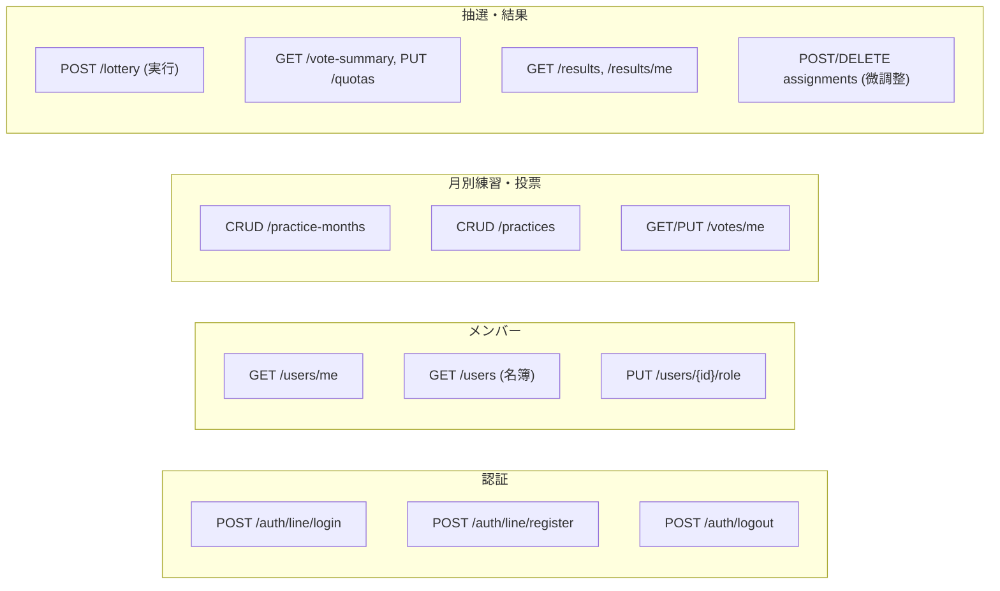

---
hide:
- navigation
doc_type: api-design
version: 2.11.0
last_updated: '2026-10-27'
depends_on:
- requirements/index.md
- database-design/index.md
derived_by:
- ui-design/index.md
sync_hash: 153493a5b5a6
dependency_hashes:
  requirements/index.md: 8ee4d7df8a9f
  database-design/index.md: c60d9e4e6002
---

# API設計書 — サークル練習参加抽選システム

## 1. API概要

FastAPI で実装する RESTful API。フロントエンド (Next.js) から HTTP で呼び出される。リソースは大きく5つ: **認証 (auth)**、**メンバー (users)**、**月別練習 (practice-months / practices)**、**投票 (votes)**、**抽選・結果 (lottery / results)**。

## 2. 認証・認可

- **認証方式**: JWT Bearer Token（`Authorization: Bearer <token>`）
- ログイン成功時にアクセストークンを発行。以降のリクエストはすべてトークン必須（`/auth/*` の一部を除く）
- **ログインは LINE のみ**（D-021 / D-042）: LIFF が発行した ID トークンを `POST /auth/line/login` に送る。サーバーは LINE の検証エンドポイント（`https://api.line.me/oauth2/v2.1/verify`）に `id_token` と `client_id`（チャネルID）を送って検証し、応答の `sub` を LINE ユーザーIDとして本人を特定する。**クライアントから送られたユーザーIDは信用しない**（詐称を防ぐため）
- **代表も同じ経路**: 代表専用のログイン手段は設けない。メンバーとして LINE ログインしたうえで代表権限を付与する（D-042）
- **ロール**:

| ロール | 権限 |
|--------|------|
| member | 自分のプロフィール取得・投票・自分の抽選結果の閲覧。本人向けプロフィール更新APIは提供しない (D-049) |
| representative（代表） | member の全権限 + 男女の日程作成・担当性別の既存日程管理／抽選実行／結果微調整 + 名簿閲覧（男女全体: REQ-007.1）+ 設定変更 |

- **性別スコープ** (NFR-002.4): 旧個別更新API・単独削除、投票期間変更・抽選・微調整・公開は現在のユーザーと対象リソースの `gender` が一致しない場合 `403` を返す。一括登録APIと新しい男女変更を含む編集APIは代表が両性別を対象に操作できる (D-060 / D-062 / D-063)。名簿 (`GET /users`) は男女全体を返す。代表権限の変更も男女全体を対象とする (D-040)。月別練習の閲覧系（一覧・詳細・公開後の参加表）は性別を問わず閲覧できる (D-038)。投票は自分の性別グループのみ (403)

### 日程の男女一括作成 (D-060)

日程作成の `capacity` は任意・非推奨とする (D-064)。新UIは送信せず、新規日程はNULLを返す。既存日程の更新ではcapacityを変更しない。`Practice / PracticeVoteSummary / PracticeSuggestion` のcapacityはNULL許容である。旧クライアントが明示した正のcapacityは作成時の互換用暫定値としてのみ受付ける。

`PUT /practice-months/{pmId}/quotas` は各学年を重複なく指定したことを検証し、学年枠とその合計capacityを同時に保存する。全学年0人ならcapacity=0。未固定日で枠未設定・capacityがNULL・合計不一致なら `POST /lottery` は409。`quotas_ready` も同じ条件でfalseとなる。固定日は既存の保護を維持する。定員未設定の手動追加ではcapacity_exceededをfalseとし、不明な定員との比較は行わない。

- `POST /practice-months/batch`: 既存の月作成本文に `genders: ["male", "female"]` を加える。対象は1〜2件・重複不可。月がなければ作成し、既存月は再利用する。同日を入力候補へ更新、未登録日は追加、同値はスキップし、201で最新の月詳細の配列を返す (D-062)。既存月の受付期間・公開状態、投票・割当・未指定の日程は維持する。旧 `POST /practice-months` は担当性別だけの作成・既存月409を維持する。
- `POST /practices/batch`: `{ year_month, genders, practice }` を受け取り、対象月をID順にロックして同日を更新・未登録日を追加する。201で保存した練習日配列（各要素に `practice_month_id` を含む）を返す。対象月が一方でも未作成なら404。
- 一括登録は練習日IDを維持し、同じ入力の再送で重複を作らない。入力内で同日・同性別が複数あれば最後を採用する。既存データに同日・同性別が複数あれば409。固定日の変更は409、同値は成功とする。男女の更新・追加をまとめてロールバックする。同時の月作成競合も409である。
- いずれも代表認証を必須とし、入力不正は400、未認証は401、一般メンバーは403。練習日は対象月内に限定する。コミット失敗を成功として返さず、ロールバックする。男女のID・定員・投票・割当は共有しない。

新規月の各 `practices[]` には任意の `genders` を指定できる (D-061)。指定された日を該当性別にだけ保存する。省略時は月レベルの `genders` を引き継ぐ。日ごとの対象は空・重複を許可せず、月レベルの対象の部分集合であることを必須とする（違反時400・全件取り消し）。UIは各日の対象の和集合を月レベルへ送信する。日程なしでは表示中の性別を送信する。

### 既存練習日の男女変更 (D-063)

既存日の編集用に `GET /practices/{practiceId}/genders` を追加する (D-063)。代表のみ利用でき、`practice / genders / available_genders / versions`（性別ごとのID・updated_at）を返す。同日・同月の両性別を取得し、曖昧な同日複数行は409とする。

`PUT /practices/{practiceId}/genders` は `genders / practice / expected_versions` を受け取る。性別選択を保った行は更新、不足側は追加、外した側は論理削除し、コミット後204を返す。外した側に有効な投票・割当がある、固定日の性別変更・更新、更新版の不一致、日付変更先の衝突は409。対象月未作成・練習日不明は404、一般メンバーは403、未認証は401、入力不正は400。全件をロールバック可能な単一トランザクションとする。投票・割当は残す側に維持し、新規側にはコピーしない。

### メンバーホーム向けBFF (D-051)

`GET /api/member/home?gender=male|female&month={pmId}` はNext.js専用の集約APIであり、バックエンドの `/api/v1` APIを置き換えない。`month` を省略すると最新月を選ぶ。返却値は `user / months / detail / voteStatus / myResults / participation` とし、該当月がない場合は詳細以降をnullにする。対象の本人情報と月一覧を並行取得し、日程・本人の投票（公開前かつ同じ性別の非閲覧専用ユーザー）・公開結果（公開後）を並行取得する。管理用 `/results` は取得しない。CookieのJWTを各APIへ渡して認証・権限・公開状態の確認を維持する。

認証・対象月・公開状態の拒否を含む取得失敗はHTTPエラーとして返す。BFFレスポンスは `Cache-Control: private, no-store` と `Vary: Cookie` を指定し、共有CDNへキャッシュしない。端末キャッシュは認証後の画面表示専用である。BFFログの `backendRequests / totalMs` は通信回数と所要時間のみを記録し、ID・投票内容・トークンは記録しない。

## 3. 共通仕様

| 項目 | 仕様 |
|------|------|
| ベースURL | `/api/v1` |
| リクエスト/レスポンス形式 | JSON (UTF-8)。204は本文なし。CSV出力APIは廃止 (D-049) |
| 日時形式 | ISO 8601。**レスポンスは必ずオフセット付きの UTC**（例: `2026-08-01T10:53:15.860494Z`）。リクエストはオフセット付きであれば任意のタイムゾーンを受け付け、サーバー側で UTC に正規化する。月は `YYYY-MM`（D-013） |
| ID形式 | プレフィックス付き ULID（例: `usr_01H...`） |
| ページネーション | 名簿一覧のみ `?page=&per_page=`（既定 per_page=50、150名規模のため任意） |
| レート制限 | 初期スコープでは設けない（150名規模のため） |

### エラーレスポンス

```json
{
  "error": {
    "code": "VALIDATION_ERROR",
    "message": "入力内容に誤りがあります",
    "details": [{ "field": "grade", "reason": "less_than_equal" }]
  }
}
```

| HTTP | code 例 | 意味 |
|------|---------|------|
| 400 | VALIDATION_ERROR | 入力不正 |
| 401 | UNAUTHORIZED | 未認証・トークン無効 |
| 403 | FORBIDDEN | 権限不足・性別スコープ違反 |
| 404 | NOT_FOUND | リソースが存在しない |
| 409 | CONFLICT | 状態の競合（締切後の投票、二重登録等） |

## 4. エンドポイント一覧



### 認証 (auth)

| メソッド | パス | 概要 | 権限 | 要件 |
|----------|------|------|------|------|
| POST | /auth/line/login | LINE ログイン（LIFF の ID トークンを検証。未登録なら `registered: false`） | 不要 | REQ-001.1, REQ-001.6 |
| POST | /auth/line/register | 初回登録（本名・学年・性別を受け取り会員作成。JWT を発行） | 不要 | REQ-001.5 |
| POST | /auth/logout | ログアウト（Cookie を破棄。呼び出す画面は未提供） | member | REQ-001.3 |

### メンバー (users)

| メソッド | パス | 概要 | 権限 | 要件 |
|----------|------|------|------|------|
| GET | /users/me | 自分のプロフィール取得 | member | REQ-002 |
| GET | /users | 名簿一覧（検索・絞り込み。男女全体） | 代表 | REQ-007.1, REQ-007.1.1 |
| PUT | /users/{userId}/role | 代表権限の付与・剥奪（男女全体: D-040） | 代表 | REQ-007.2 |
| DELETE | /users/{userId} | メンバー無効化（論理削除） | 代表 | REQ-007.3 |

### 月別練習 (practice-months / practices)

| メソッド | パス | 概要 | 権限 | 要件 |
|----------|------|------|------|------|
| GET | /practice-months | 月別練習の一覧（既定は自性別。`?gender=` で他方も閲覧可 (D-038)。`?year_month=` 絞り込み） | member | REQ-004.1 |
| POST | /practice-months | 月別練習単位の作成（投票期間含む） | 代表 | REQ-003, REQ-003.3 |
| POST | /practice-months/batch | 対象性別を選んで月と練習日を原子的に一括作成 | 代表 | REQ-003.9 |
| POST | /practices/batch | 対象性別の既存月に練習日を原子的に一括追加 | 代表 | REQ-003.9 |
| GET | /practice-months/{pmId} | 詳細（練習日一覧含む） | member | REQ-004.1 |
| PUT | /practice-months/{pmId} | 投票期間・枠比率等の更新 | 代表 | REQ-003.3, REQ-005.5 |
| POST | /practice-months/{pmId}/practices | 練習日の追加 | 代表 | REQ-003.1, REQ-003.2 |
| GET | /practices/suggestions | よく使う練習の候補（履歴から） | 代表 | REQ-003.6 |
| PUT | /practices/{practiceId} | 練習日の更新 | 代表 | REQ-003.4 |
| GET | /practices/{practiceId}/genders | 同日の男女登録・更新版の取得 | 代表 | REQ-003, D-063 |
| PUT | /practices/{practiceId}/genders | 内容・男女選択の原子的な更新 | 代表 | REQ-003, D-063 |
| DELETE | /practices/{practiceId} | 練習日の削除（抽選後は警告フラグ） | 代表 | REQ-003.4 |

### 投票 (votes)

| メソッド | パス | 概要 | 権限 | 要件 |
|----------|------|------|------|------|
| GET | /practice-months/{pmId}/votes/me | 自分の投票状況 | member | REQ-004.4 |
| PUT | /practice-months/{pmId}/votes/me | 投票の登録・変更（practice_id の配列で全置換） | member | REQ-004.2, REQ-004.3 |

- 締切後 (`vote_ends_at` 超過) の PUT は `409 CONFLICT` を返す (REQ-004.3)

### 抽選・結果 (lottery / results)

微調整画面は `PUT /practice-months/{pmId}/assignments` で差分を一括保存する (D-052)。本文は `changes`（1〜5000件）、`expected_month_status`、`expected_published_at`。各差分は練習日・会員ID・参加の有無・変更前割当ID・変更前公開状態を持つ。全件検証後に1トランザクションで保存し、成功は204（本文なし）。基準や公開状態の競合は409、重複差分や入力不正は400、不明な練習日・会員は404、担当外性別・閲覧専用は403。同じ保存を再送した場合、既に同じ参加状態なら成功扱いにする。単件追加・削除APIは互換性のため維持するが、この画面からは呼ばない。メンバーへの公開仕様はD-044のままである。

| メソッド | パス | 概要 | 権限 | 要件 |
|----------|------|------|------|------|
| GET | /practice-months/{pmId}/vote-summary | 抽選前の投票状況と学年別枠（提案値含む） | 代表 | REQ-005.5, REQ-005.5.1 |
| PUT | /practice-months/{pmId}/assignments | 微調整の差分を一括保存（公開まで保留） | 代表 | REQ-006.3 / D-052 |
| PUT | /practice-months/{pmId}/quotas | 学年別の参加人数枠を保存（合計＝定員） | 代表 | REQ-005.3 |
| POST | /practice-months/{pmId}/lottery | 抽選の一括実行（再実行含む。枠未設定なら409） | 代表 | REQ-005, REQ-005.12 |
| GET | /practice-months/{pmId}/executions | 抽選実行履歴 | 代表 | REQ-005.11 |
| GET | /practice-months/{pmId}/results/me | 自分の当選結果（公開後のみ） | member | REQ-006.1 |
| GET | /practice-months/{pmId}/participation | 練習参加表（学年別。全メンバーを並べ、未投票は `has_voted = false`。公開後のみ: D-043） | member | REQ-006.5 |
| GET | /practice-months/{pmId}/results | 全結果（練習日別・メンバー別） | 代表 | REQ-006.2 |
| POST | /practices/{practiceId}/assignments | 参加者の手動追加 | 代表 | REQ-006.3 |
| DELETE | /assignments/{assignmentId} | 参加者の手動削除 | 代表 | REQ-006.3 |
| POST | /practice-months/{pmId}/publish | 結果の公開 | 代表 | REQ-006.4 |

- 未公開 (`status != published`) の `/results/me` は `404` を返す (REQ-006.4)
- 公開後の微調整は `assignments.publish_state` で保留され、メンバー向けの `/results/me`・`/participation` には再公開まで反映されない。`POST /publish` は公開済みの月にも実行でき、再公開として保留分を確定する (D-044)
- `GET /results` の `by_member` は性別グループの**全メンバー**を返す。未投票者も `votes_count = 0` で含める（誰が投票していないかを結果画面で把握するため: D-043）
- 抽選の再実行時は既存の有効な実行が `is_active = false` になり、割当が置き換わる (REQ-005.12)
- D-053の固定日がある場合、置換と抽選入力は未固定日だけに限定する。公開済みの月はpublishedと公開日時を保持し、固定日の公開結果だけを維持する。未固定日の新しい割当はpendingであり、再公開まではメンバー向け結果に含めない。全日固定、または固定日に未確定の割当がある場合は抽選409。固定日フラグはAPIに追加しない。
- 固定日に対する追加・削除・一括微調整、枠変更、練習日更新・削除は409（同値の枠再送は許可）。投票PUTの全置換では固定日の投票を変えない場合のみ受付する。公開時は固定割当を変更せず、月次実績は月全体を集計する。
- 固定日の先行公開月では受付期間中の未固定日への投票を許可する (D-054)。`GET /votes/me` は `locked_practice_ids` と、本人の性別・閲覧専用・学年・受付期間・未固定日の有無を考慮したeditableを返す。固定日なしの通常の公開月は投票PUTが409。BFFのホーム集約は受付期間中の公開月では投票状況と公開結果を並行取得し、締切済み公開月では投票取得を省く。

### 設定 (settings)

| メソッド | パス | 概要 | 権限 | 要件 |
|----------|------|------|------|------|
| GET | /settings | 抽選設定の取得（担当性別） | 代表 | NFR-004.1 |
| PUT | /settings | 落選救済係数 α の更新 | 代表 | NFR-004.1 |

## 5. API仕様詳細

<swagger-ui src="openapi.yaml"/>

詳細は [openapi.yaml](openapi.yaml) を参照。

## 6. 要件トレーサビリティ

| 要件 | 対応エンドポイント |
|------|--------------------|
| REQ-001 (認証) | POST /auth/line/login, /auth/line/register, /auth/logout |
| REQ-002 (プロフィール) | POST /auth/line/register, GET /users/me。登録後の変更は管理者がDBで行う |
| REQ-003 (練習日程管理) | POST/PUT /practice-months, POST/PUT/DELETE /practices, GET /practices/suggestions |
| REQ-004 (投票) | GET /practice-months, GET/PUT /practice-months/{pmId}/votes/me |
| REQ-005 (抽選) | POST /practice-months/{pmId}/lottery, GET /vote-summary, PUT /quotas, GET /executions |
| REQ-006 (抽選結果) | GET /results/me, GET /results, GET /participation, POST/DELETE assignments, POST /publish |
| REQ-007 (メンバー管理) | GET /users, PUT /users/{userId}/role, DELETE /users/{userId} |
| NFR-002.3〜4 (アクセス制御) | 全エンドポイントのロール・性別スコープ検証 (403) |
| NFR-004.1 (設定変更) | GET/PUT /settings, PUT /practice-months/{pmId}/quotas |
