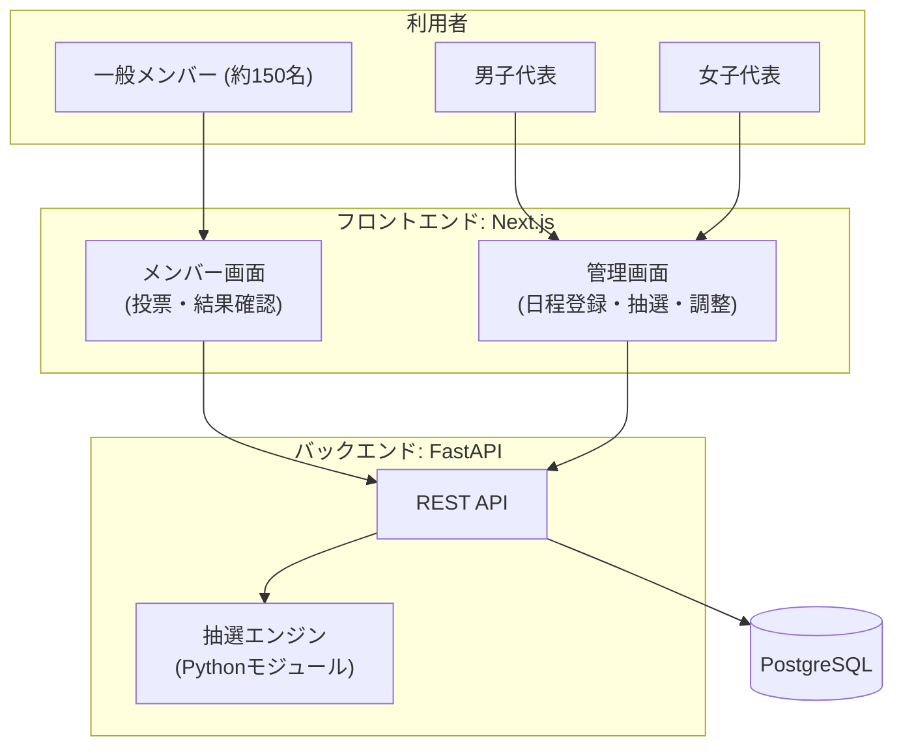

---
hide:
- navigation
doc_type: requirements
version: 4.21.0
last_updated: '2026-10-30'
depends_on:
- business-plan/index.md
derived_by:
- api-design/index.md
- database-design/index.md
- ui-design/index.md
- infrastructure-design/index.md
sync_hash: da22ab9916ea
dependency_hashes:
  business-plan/index.md: 95db25dcaa0b
---

# 要件定義書 — サークル練習参加抽選システム

## 1. プロジェクト概要

約150名が在籍する大学バレーボールサークルの練習参加抽選を自動化する Web システム。メンバーは月ごとに参加したい練習日へ投票し、代表がボタン一つで公平な重み付き抽選を実行する。詳細な背景・課題は[事業計画書](../business-plan/index.md)を参照。

## 2. システム概要



### 技術スタック / アーキテクチャ方針

フロントエンドとバックエンドを分離した2サービス構成とする。選定理由: 責務の境界が物理的に分かれることによる開発者の理解のしやすさ、および本プロジェクトの開発ワークフロー（レイヤードAPI開発・マイグレーション・テストの各スキル）との適合を優先する。トレードオフとして2サービスのデプロイ管理を受け入れる。バックエンドのコールドスタートは Render の有料プラン利用により解消した。

| レイヤー | 技術 | 補足 |
|----------|------|------|
| フロントエンド | Next.js (App Router) + TypeScript + Tailwind CSS | 画面のみを担当。API はバックエンドを HTTP で呼び出す |
| UI方針 | **全画面モバイルファースト** | メンバー・代表とも利用はスマホ前提。管理画面（抽選実行・微調整・名簿閲覧）もスマホで完結できること |
| バックエンド | Python + FastAPI（レイヤードアーキテクチャ） | router / service / repository の3層構成 |
| 抽選エンジン | 純粋な Python モジュール | API・DB から独立させ、単体でテスト可能にする（シード指定で決定的に動作） |
| データベース | PostgreSQL + SQLAlchemy (ORM) + Alembic (マイグレーション) | JSON型は jsonb を使用 |
| 認証 | LINE ログイン（LIFF）| LIFF の ID トークンをサーバー側で LINE に検証させ、LINE ユーザーIDで本人を特定する。検証後は JWT Bearer Token を発行する (D-021) |
| インフラ | Vercel（フロントエンド）/ Render（バックエンド・有料プラン）/ Supabase（PostgreSQL） | 詳細はインフラ設計書を参照 |

## 3. 機能要件 (USDM)

### REQ-001: 認証

| ID | 要求 | 理由 | 説明 |
|----|------|------|------|
| REQ-001 | メンバー・代表とも LINE ログインで本人を識別されること | 投票内容を本人のみが操作できるようにするため。URLは LINE で共有されるため、LINE ログインなら手間が増えない (D-021) | 代表もメンバーと同じ経路でログインする。認証後は JWT を発行する |
| REQ-001.1 | メンバーは LINE アカウントでログインできること | 投票URLは LINE で共有され、LINE アプリ内ブラウザで開かれるため、ログイン操作を挟まずに本人を特定できる (D-021) | LIFF で取得した ID トークンをサーバー側で LINE に検証させ、その結果の LINE ユーザーIDで本人を特定する。ブラウザから送られたIDをそのまま信用しない |
| REQ-001.2 | 代表もメンバーと同じ LINE ログインを使うこと | 代表専用のログイン手段を設けると、パスワード管理と引き継ぎの手間が増えるため | メンバーとして LINE ログインしたうえで、代表権限を付与して代表になる。メールアドレス + パスワードによるログインは採用しない |
| REQ-001.3 | ログアウトできること | 共用端末での利用も想定されるため | サーバー側は Cookie を削除するのみ（JWT はステートレス）。**現状このAPIを呼ぶ画面はなく、ログアウトの導線は未提供**。LINE アプリ内ブラウザでの利用が前提のため優先度は低い |
| REQ-001.5 | 初回のみ本名・学年・性別・マネージャー区分を登録できること | LINE から取得できるのは表示名とアイコンのみで、本名・学年・性別は取得できないため (D-021) | 表示名はニックネームであることが多く、代表が抽選結果を確認できないため本名を入力させる。2回目以降は LINE ユーザーIDで引き当てるため入力不要 |
| REQ-001.6 | 一度登録したメンバーは、以後URLを開くだけで投票画面に到達できること | 投票のたびに入力を求めると回答率が下がるため (D-021) | LINE ユーザーIDから登録済みの会員を引き当て、そのまま JWT を発行する |

### REQ-002: プロフィール管理

| ID | 要求 | 理由 | 説明 |
|----|------|------|------|
| REQ-002 | メンバーは初回ログイン時に自分のプロフィールを登録すること | 抽選に必要な学年・性別・マネージャー区分を保持するため | 初回のみ登録を必須とする。登録後に本人が編集する画面は設けない |
| REQ-002.1 | 名前・学年・性別・マネージャー区分を登録できること | 抽選に必要な項目に限定する。住所・電話番号・メールアドレス・学部学科・学籍番号は本システムでは保持しない (D-021) | 全項目必須。学年は1〜3年（4年は在籍しない）。性別は男 / 女（抽選グループの決定に使用） |
| REQ-002.2 | 登録済みプロフィールの変更は管理者が行うこと | 進級による学年の繰り上げは全員に一斉に発生するため、各自の更新に任せると抜け漏れが生じるため | 学年・性別・マネージャー区分の変更は管理者が DB を直接更新する運用とする。本人向けの編集画面・更新APIは提供しない (D-049) |
| REQ-002.3 | 他のメンバーのプロフィールは閲覧できないこと | 不必要な情報の共有を避けるため | 名簿の閲覧は代表のみ（REQ-007） |

### REQ-003: 練習日程管理（代表）

| ID | 要求 | 理由 | 説明 |
|----|------|------|------|
| REQ-003 | 代表は月ごとの練習日程を登録・管理できること | 投票と抽選の前提となる情報のため | 登録・既存日の編集で男子・女子・両方を選択できる。性別解除時は投票・割当・固定を保護する。代表は男女双方を管理可能 (D-068) |
| REQ-003.1 | 練習日（日付・開始/終了時刻）と練習場所を登録できること | メンバーが投票時に判断する基本情報のため | 月単位でまとめて登録・編集できる |
| REQ-003.2 | 定員は抽選準備で学年別人数を保存した時点で確定すること | 日程作成時の仮定員との二重管理を避けるため | 日程作成・編集に人数欄は置かない。未設定はNULL、学年枠合計を定員とする (D-064) |
| REQ-003.3 | 投票の受付期間（開始・締切）を設定できること | 締切後に抽選を実行する運用のため | 締切後は投票の新規・変更を不可とする。指定は**日付のみ**で、開始日の0:00〜締切日の23:59とする (D-014) |
| REQ-003.4 | 登録済みの練習日程を編集・削除できること | 施設都合による変更に対応するため | 抽選実行後の削除は確認ダイアログで警告 |
| REQ-003.5 | 練習の開始・終了時刻は30分単位で指定できること | 分単位の入力は不要で、選択肢が多いと入力の手間になるため | サーバー側でも30分単位であることを検証する (D-014) |
| REQ-003.6 | 過去に登録した練習（場所・開始/終了時刻）を候補として選び、入力を省略できること | 毎月ほぼ同じ体育館・同じ時間帯を登録するため | 管理対象性別の過去実績を利用回数の多い順に提示する (D-068)。定員は引き継がない (D-014 / D-064) |
| REQ-003.7 | 登録済みの練習と同じ内容（場所・時刻・対象学年・備考）で、日付だけ変えて追加できること | 同じ月内で同じ体育館・時間帯の練習が複数回あるため | 日付のみ空にし、定員・学年枠は複製しない (D-014 / D-064) |
| REQ-003.8 | 月の練習日程を作成する前に、入力内容を一覧で確認できること | 練習日を複数まとめて登録するため、送信前に誤りに気づけるようにするため | 対象月・投票期間・練習日一覧を日付順に表示し、「修正する」で入力に戻れる。同じ日付が重複している場合は注意を表示する (D-016) |
| REQ-003.9 | 練習日ごとに登録対象を男子・女子・両方から選べること | 共通日と男女別の日程を一度に登録するため | 月の新規作成でも日ごとに指定可能。男女別レコードを1トランザクションで作成し、定員・投票・抽選は独立させる (D-060 / D-061) |

### REQ-004: 投票

| ID | 要求 | 理由 | 説明 |
|----|------|------|------|
| REQ-004 | メンバーは月ごとに参加したい練習日へ投票できること | 参加希望の収集が抽選の入力となるため | 受付期間内のみ投票可能 |
| REQ-004.1 | その月の練習日一覧（日付・時間・場所・定員）を確認できること | 投票の判断材料のため | 自分の性別グループの練習のみ表示 |
| REQ-004.2 | 複数の練習日を選択して投票できること | 参加したい日をまとめて申告するため | 1日〜全日まで任意の数を選択可能 |
| REQ-004.3 | 締切前であれば投票内容を変更できること | 予定変更に対応するため | 締切後は変更不可 |
| REQ-004.4 | 自分の投票状況を確認できること | 投票済みかどうかを確認できるようにするため | 投票済みの日に印を表示 |

### REQ-005: 抽選

| ID | 要求 | 理由 | 説明 |
|----|------|------|------|
| REQ-005 | 代表は月単位で参加者の抽選を一括実行できること | 手動抽選の作業負荷をなくすことが本システムの目的のため | ボタン一つで担当性別グループの全練習日の抽選を実行 |
| REQ-005.1 | 男子と女子の抽選は完全に独立して実行できること | 男女それぞれに代表がおり、独立して運用されるため | 抽選対象・定員・実行タイミングとも互いに影響しない |
| REQ-005.2 | マネージャーは投票した練習日すべてに定員外で参加できること | マネージャーはプレイヤーではなく練習運営に必要なため | 定員（プレイヤー数）に数えず、抽選対象外で全参加とする |
| REQ-005.3 | 代表は練習日ごとに1年・2年・3年の参加人数を設定できること | 上級生を優先したいが、その度合いは月や日の投票状況によって変わるため | 保存時に学年枠合計を定員へ反映する。未固定日で未設定・定員不整合なら抽選409。明示的な全学年0人は設定済みとして扱う (D-015 / D-064) |
| REQ-005.4 | 学年ごとに独立した抽選を行うこと | 1年生の人数が多く、学年をまたいで同じ基準で競わせると上級生が不利になるため | 各学年は自分の枠の中で抽選する。**ただし投票者が足りず枠が余った場合は、余りを他学年へ回して定員を埋める** (D-027)。学年間の独立性は「各学年の投票者が枠を満たしている」ことが前提となる |
| REQ-005.5 | 抽選実行前に、練習日ごとの学年別投票状況を確認できること | 参加人数を決める判断材料が必要なため | 日ごとに学年別の投票者数をグラフで表示し、その場で人数を調整・保存できる (D-015) |
| REQ-005.5.1 | 学年別参加人数の初期値をシステムが自動提案すること | 毎回ゼロから入力するのは手間なため | **定員を学年数で等分する**（定員30なら 10/10/10）。割り切れない端数は3年→2年→1年の順に配る。運用実態が各学年10人ずつのため、投票状況では変えない (D-028)。代表は自由に上書きできる |
| REQ-005.6 | 投票したメンバーは月に最低1回は当選すること | 「投票したのに月0回」の不公平を作らないため | 最優先に全投票者へ1枠を保証割当する。まず自学年の枠内で配置し、入れなかった人だけ**他学年の余り枠も使って配置し直す** (D-029)。いずれも先にその日に入っている人を別の投票日へ移して席を空ける (D-017 / D-036)。席が構造的に足りない場合のみ警告する |
| REQ-005.7 | 投票数が多いメンバーほど多くの練習に参加できること | 3日投票した人が1日だけ投票した人と同じ参加数では不公平なため | 最低1回保証の後の残枠でのみ、投票数に比例した機会で配分する（保証が常に優先） |
| REQ-005.8 | 月内の当選回数が特定メンバーに偏らないこと | 参加機会の平準化のため | 残枠配分は「当選数÷投票数」が小さいメンバーを優先するラウンド方式とする |
| REQ-005.9 | 過去に落選したメンバーの当選確率が上がること | 連続落選による不満を救済するため | 前月までの落選数に応じた救済係数を抽選の重みに乗算する |
| REQ-005.10 | 投票者が足りず余った枠は他学年へ回し、それでも埋まらない場合のみ空席として警告すること | 体育館の枠を無駄にしないため (D-027) | 余りは学年を順に回して1人ずつ配り、特定の学年に偏らせない。全学年を配りきってもなお余る場合だけ「N枠が空席」と警告する |
| REQ-005.11 | 抽選の実行履歴（実行日時・実行者・乱数シード・学年別枠・結果）が記録されること | 抽選の公平性を事後検証できるようにするため | 同一シードで結果を再現可能とする。実行時の学年別枠もあわせて記録する (D-015) |
| REQ-005.12 | 抽選の再実行ができること | 誤操作や日程変更時にやり直せるようにするため | 再実行時は未固定日の前回結果を破棄し、確認ダイアログで警告。管理者が固定した日は保護する (D-053) |

### REQ-006: 抽選結果

| ID | 要求 | 理由 | 説明 |
|----|------|------|------|
| REQ-006 | 抽選結果を確認できること | 参加日を各自が把握することが運用の前提のため | メンバーと代表で表示範囲が異なる |
| REQ-006.1 | メンバーは自分の当選した練習日（日付・時間・場所）を確認できること | CSV から自分を探す現状の手間をなくすため | カレンダー/リスト形式で自分の参加日を表示 |
| REQ-006.2 | 代表は練習日ごとの参加者一覧を確認できること | 練習運営・出欠管理に必要なため | 練習日別・メンバー別の両方の視点で表示。メンバー別は未投票者も含めた全員を並べる (D-043) |
| REQ-006.3 | 代表は抽選結果を手動で微調整できること | 個別事情（怪我・行事等）に対応するため | マス操作は画面内のみで行い、差分を一括保存してから公開／再公開する。人数・当選回数・未保存件数を即時更新し、保存済みの公開待ち件数と区別する。定員超過時は警告。保存後も公開まではメンバーに見えない (D-044 / D-052) |
| REQ-006.4 | 抽選結果が確定するまでメンバーには結果を非公開にできること | 微調整中の結果が見えると混乱するため | 代表の「公開」操作により全メンバーへ公開。公開後の微調整は「再公開」でまとめて反映 (D-044) |
| REQ-006.5 | メンバーは月の練習参加表（誰がどの日に参加するか）を閲覧できること | 従来 Excel の参加表で全員が把握していた情報であり、自分以外の参加者が分かると練習の見通しが立つため (D-025) | 縦にメンバー・横に練習日を並べた表。学年ごとに区切る。参加しない人・未投票の人も含めて全メンバーを並べる (D-043)。表示するのは氏名・学年・マネージャー区分・投票有無のみ。**公開後のみ**閲覧でき、自分の性別グループに限る |

### REQ-007: メンバー管理（代表）

| ID | 要求 | 理由 | 説明 |
|----|------|------|------|
| REQ-007 | 代表はメンバーを管理できること | 代表交代・退会処理に必要なため | 代表権限でのみアクセス可能 |
| ~~REQ-007.1~~ | ~~名簿（一覧表）形式での閲覧~~ | — | **廃止 (D-026)**。個人情報は Google フォームで管理しており (D-021)、本システムが持つのは氏名・学年・性別のみ。それらは練習参加表 (REQ-006.5) で確認できる |
| ~~REQ-007.1.1~~ | ~~名簿の絞り込み・検索~~ | — | **廃止 (D-026)** |
| ~~REQ-007.1.2~~ | ~~名簿の CSV エクスポート~~ | — | **廃止 (D-026)**。名簿提出に必要な項目を保持しなくなったため用を成さない |
| REQ-007.2 | メンバーに代表権限を付与・剥奪できること | 代表交代時の引き継ぎのため | 男子代表・女子代表の2ロール。付与は既存代表のみ可能。**設定画面から行う** |
| REQ-007.3 | 退会したメンバーを無効化できること | 卒業・退会者を抽選対象から除外するため | 論理削除（is_deleted）とし、履歴は保持する。**現在は画面からの導線がなく、API のみ** (D-026) |

### 抽選アルゴリズム仕様（REQ-005 の詳細）

抽選は性別グループごとに独立して、以下の手順で月単位に実行する。

```
入力: 練習日リスト（各定員 C_d、学年別枠 Q[d][g] ※代表が抽選前に設定）、
      投票（メンバー m × 練習日 d）
重み: w(m) = 落選救済係数(m) = 1 + α × 前月落選数（α は設定値、既定 0.5。D-032）
前提: 全練習日の全学年に枠が設定されていること（未設定なら抽選は実行できない）

Phase 0 — マネージャー:
    投票した練習日すべてに参加（定員外・カウントしない）

Phase 1 — 保証（席の入れ替えを伴う最大マッチングで一体に解く。D-036）:
    1-a. 最低1回保証・自学年の枠内: その学年の全投票者へ投票日の中から1枠を割当。
         空きがない日しか選べない人が出た場合は、先に入っている人を
         別の投票日へ移して席を空ける (D-017)
    1-b. 最低1回保証・他学年の余りも使う: 1-a で入れなかった人だけを対象に、
         他学年の余り枠も借りて配置し直す。学年内で解く限り構造的に
         入れない人が出るため (D-029)。その日の総席数は常に確認する
    1-c. 前月不遇者の2席目: 前月3日以上投票して当選1回以下、かつ今月も
         3日以上投票している人へ、残枠配分の前に2席目を確保する (D-035)。
         抽選ではなく確保として働き、ここでも席の入れ替えが使える (D-036)

Phase 1-d — 残枠配分: 枠が残る限りラウンドを繰り返す
    - 「(前月＋今月) の当選数 ÷ (前月＋今月) の投票数」が最小のメンバー群を選ぶ。
      前月不遇だった人は順位として先頭グループに入る (D-034)。
      前月データがない人は今月だけの当選率で比べる
    - その中から重み w(m) の重み付き抽選で1名を選び、
      未当選かつ空きのある投票日へ1枠割当

Phase 2 — 学年をまたいだ余り枠の再配分 (D-027):
    投票者が足りずに余った枠は空席にせず、他学年へ学年順に1人ずつ配る
    全学年を配りきってもなお余る場合のみ「N枠が空席」と警告する

実行ごとの内部検証 (D-036):
    定員超過・二重割当・「空席があるのに入れる人がいる」・
    「空席のある日に投票したのに月0回」の4条件を毎回機械チェックし、
    破れていれば「内部検証:」で始まる警告を代表の画面に出す

出力: 練習日ごとの参加者リスト、落選記録（次月の救済係数に反映）、
      乱数シード、使用した学年別枠
```

**枠の自動提案**（REQ-005.5.1・初期値の算出。代表は上書き可能。D-031）

日ごとに完結して算出し、月をまたいだ按分は行わない。

```
1. 基準は定員の等分（定員30なら各学年10）
2. 各学年に「その日の投票者数」と「基準」の少ないほうを割り当てる
   → 投票が基準に満たない学年の枠は、書いても埋まらないため
3. 余った席は 3年 → 2年 → 1年 の順に、投票者数を上限として配る
   → 上級生優先の方針 (D-015) をここでも踏襲する
4. それでも余る席（全学年の投票者が定員未満の日）は1年に載せて合計＝定員を保つ
   → 埋まらない席は抽選側が他学年へ回すため (D-027)、どの学年に置いても結果は変わらない

※ 学年限定の日 (D-037) は、定員の等分・余りの配分を参加できる学年の中だけで行う
```

### REQ-008: 代表向けアップデート履歴

| ID | 要求 | 理由 | 説明 |
|----|------|------|------|
| REQ-008 | 代表は下部メニューの「更新」から機能追加・改善の履歴を確認できること | 運用者が操作や仕様の変更をアプリ内で把握できるようにするため | 抽選除外機能の追加 (D-053) 以降を新しい順に掲載。履歴は実装と同時に追記し、公開日不明のものは推測しない (D-066) |

## 4. 非機能要件

### NFR-001: パフォーマンス

| ID | 要求 | 理由 | 説明 |
|----|------|------|------|
| NFR-001.1 | 150名 × 月10練習日規模の抽選が10秒以内に完了すること | 代表がボタン実行後すぐ結果を確認できるようにするため | 非同期実行とし、完了後に結果画面へ反映 |
| NFR-001.2 | 通常画面の応答が2秒以内であること | スマホからのストレスない利用のため | 投票期間中のアクセス集中（150名規模）を想定 |

### NFR-002: セキュリティ

| ID | 要求 | 理由 | 説明 |
|----|------|------|------|
| NFR-002.1 | 通信はすべて HTTPS で暗号化すること | 本名と LINE ユーザーIDを扱うため | — |
| NFR-002.2 | LINE ユーザーIDを外部に出さないこと | 本システムで最も機微な識別子であり、他サービスでの名寄せに使われうるため | `users.line_user_id` は API レスポンスにも画面にも出さない。本人確認は ID トークンをサーバー側で LINE に検証させて行い、クライアントから送られたIDをそのまま信用しない (D-021) |
| NFR-002.3 | メンバー情報の閲覧は代表権限のみに制限すること | メンバー間の不要な情報共有を防ぐため | API レベルでロールベースアクセス制御（RBAC） |
| NFR-002.4 | 代表は本人の性別にかかわらず男女双方の管理機能を操作できること | 代表間で管理を代行できるようにするため | 日程・投票期間・枠設定・抽選・微調整・公開・抽選設定・メンバー無効化を男女双方へ許可する。一般メンバーの権限は維持し、投票・割当・抽選データは男女別とする (D-068) |

### NFR-003: 可用性

| ID | 要求 | 理由 | 説明 |
|----|------|------|------|
| NFR-003.1 | 投票期間・結果公開直後の利用に耐えること | 利用が特定期間に集中する特性のため | 月次利用のため 24/365 の高可用性は要求しない |
| NFR-003.2 | データベースの定期バックアップを行うこと | 投票・抽選履歴の消失を防ぐため | クラウドサービスの自動バックアップを利用 |

### NFR-004: 拡張性

| ID | 要求 | 理由 | 説明 |
|----|------|------|------|
| NFR-004.1 | 抽選アルゴリズムの設定値（落選救済係数α・学年枠比率）を管理画面から変更できること | サークルの方針変更に柔軟に対応するため | コード変更なしで代表が変更可能。枠比率は毎月の抽選実行前に設定（REQ-005.5） |
| NFR-004.2 | 将来の他サークル展開を阻害しない設計とすること | 事業計画の横展開余地を残すため | サークル固有値のハードコードを避ける |

## 5. 設計判断の記録 (Decision Log)

なぜその仕様にしたのかの経緯を残す。**仕様の決定・変更時は必ずここに背景を追記すること。**

### D-001: 抽選は「学年係数の重み付け」ではなく「枠方式」を採用

- **決定**: 3年生は全通し、1・2年は残枠を学年別の枠に分割して各学年内で独立抽選する（※ **D-015 により変更**。3年生の全通しは廃止し、枠は日ごと・学年ごとに代表が決める。学年内で独立抽選する点は維持）
- **背景**: 初期案は学年係数（1年=1.0, 2年=1.2, ...）を重みに乗算する確率的な優遇だった。ユーザー（代表）から「3年は投票日全部行けるくらいにしたい」「1年生の人数が本当に多いので、1・2年を同じ基準で競わせるのは違う」という提案があり議論。枠方式は (1) 2年生が1年の物量に押し潰されるのを構造的に防げる、(2) 「1年の枠は◯人だから」と落選理由を即答でき納得感が高い、という点で係数方式より優れると判断
- **却下した代替案**: 学年係数方式 — 「なんで俺落ちたの？」に確率でしか答えられず、説明可能性で劣る

### D-002: 3年生全通しの定員超過ガード

- **決定**: 3年生だけで定員を超過した日は3年内で抽選し、代表に警告を表示する（※ **D-015 により失効**。3年生の全通し自体を廃止したため、このガードは不要になった）
- **背景**: 「100%通し」は3年の投票が定員を超えた瞬間にルール自体が破綻する。実際の規模（3年約10人 < 定員約30人）ではほぼ発動しないが、保険として仕様に残した

### D-003: マネージャーは定員外

- **決定**: マネージャーはプレイヤーではないため定員にカウントせず、投票日すべてに参加する
- **背景**: 当初は「定員内で優先当選」だったが、代表から「マネージャーはそもそもプレイヤーじゃないから人数に換算しなくていい」と指摘され、抽選対象からも定員からも外す設計に変更。抽選ロジックも単純になった

### D-004: 学年枠比率は毎月代表が手動設定

- **決定**: 1年枠・2年枠の比率は固定値にせず、代表が抽選実行前に毎月設定する（前月値を初期表示、1人あたり当選期待値を参考表示）（※ **D-015 により変更**。月単位の比率ではなく、練習日ごとに1〜3年の人数を設定する方式へ。「システムが決めず代表が判断する」という方針自体は引き継いでいる）
- **背景**: 比率の決め方は「人数比例」「固定比率」等の選択肢があったが、何%が適正かは学年構成や月の状況で変わる政治的な判断であり、システムが決めるべきでないと整理。代わりに判断材料（期待値シミュレーション）をシステムが提供する
- **却下した代替案**: 人数比例の自動計算 — 1人あたり当選期待値が学年間で同じになり「学年が上ほど優先」の方針と矛盾する

### D-005: 最低1回保証 > 投票数比例 の優先順位

- **決定**: 「投票したのに月0回」を作らない保証が常に最優先。投票数比例は保証後の残枠でのみ効く
- **背景**: 1年の人数が多い月は保証と比例が両立できない可能性がある。「公平性の最低ラインは全員に保証し、その上の贅沢分で差をつける」方が炎上しにくいと判断。規模試算（150枠 ÷ 60人 ≒ 1.6回/月）で両立可能なことも確認済み

### D-006: 枠の余りは他学年へ流し込む

- **決定**: 学年枠で使い切れなかった枠は他学年の落選者に配分する（※ **D-015 により変更**。代表が日ごとに決めた人数を勝手に変えないため、学年をまたいだ流し込みは行わず、空席のまま警告する。※ さらに **D-027 により再変更**。体育館の枠を無駄にしないため、余りは他学年へ回して定員を埋める方式に戻した）
- **背景**: 枠を固定したままだと「1年に落選者がいるのに空席のまま練習する」ことが起こる。%固定枠方式の構造的な弱点への対処として明文化

### D-007: 技術スタックは Next.js + FastAPI の分離構成

- **決定**: フロントエンド (Next.js/Vercel) とバックエンド (FastAPI/Render等) を分離した2サービス構成（※根拠の一部を D-010 で訂正）
- **背景**: 検討は3転した。(1) 当初 FastAPI 分離構成 → (2) 「150名規模・月次利用では2サービスの運用コスト（デプロイ2箇所・無料枠のコールドスタート・型定義の二重管理）が利点を上回る」として Next.js フルスタック一本に変更 → (3) 開発者本人から「フロントとバックエンドが物理的に分かれている方が理解しやすい」との判断で分離構成に最終決定。**作る本人が理解・保守できることを理論上の最適より優先した**
- **トレードオフとして受け入れたもの**: バックエンド無料枠のコールドスタート（対策: 定期ping または有料プラン）、2言語の保守
- **補足**: 抽選アルゴリズムの計算速度は選定理由にならない（どの言語でも数ミリ秒。ボトルネックは常にDB・ネットワーク・コールドスタート）

### D-010: skills の Hono.js 前提が判明した後も FastAPI を維持

- **決定**: バックエンドは FastAPI (Python) のまま変更しない。backend 系 skills（Hono.js + Drizzle + Vitest 前提）は本プロジェクトでは使用せず、その構成方針（レイヤード・Docker Compose・テスト駆動）のみ踏襲して手動構築する
- **背景**: D-007 で FastAPI を選んだ根拠の一つ「プロジェクトの skills が Python 前提」は誤認だった（実際は全 backend skills が Hono.js/TypeScript 前提）。実装開始時にこれが判明し、skills をそのまま使える Hono.js への変更も提案したが、開発者の判断で FastAPI を維持
- **却下した代替案**: Hono.js + TypeScript への変更 — skills の実装自動化をフルに使え1言語で完結するが、採用しなかった
- **受け入れたトレードオフ**: backend 系 skills（init / api-develop / db-migrate / test / seed）の自動化が使えず、FastAPI 版を手動で構築する

### D-008: 名簿の閲覧は男女全体（NFR-002.4 の例外）

- 代表管理操作の担当性別制限はD-068により変更。

- 日程の新規作成・追加の性別制限はD-060により変更。
- **決定**: 代表の操作系（日程・抽選・微調整）は担当性別に限定するが、名簿の閲覧・CSV出力は男女全体を対象とする
- **背景**: 個人情報を取得する目的が「名簿提出・緊急連絡などメンバー情報がまとめて必要になるタイミングがある」ことだったため。サークル全体の名簿が必要なユースケースに対し、閲覧だけ例外を認めても抽選運用の男女独立性は操作権限の分離で守れると判断

### D-009: 全画面モバイルファースト

- **決定**: メンバー画面だけでなく代表用の管理画面もスマホで完結できるように設計する
- **背景**: 当初はメンバー=スマホ、管理画面=PC想定だったが、代表もスマホで使うことが判明。抽選実行・微調整・名簿閲覧までスマホ前提に変更

### D-011: 新規登録はメールアドレス確認つきの自由登録とする

- **決定**: 誰でも登録フォームからアカウントを作成できる。ただし登録直後は「メール未確認」状態とし、登録したメールアドレス宛に届いた確認トークンを検証するまでログイン・投票を行えない
- **背景**: 認証方式の検討時に、(A) メール確認つき自由登録 / (B) 代表による招待制 / (C) 名簿事前登録＋初回パスワード設定 の3案を比較した。アシスタントからは、既に `import_members.py` で Excel 名簿を取り込む仕組みがあり代表が参加者を管理する運用実態があることから C を推奨したが、開発者の判断で A を採用。登録の入口を代表が握らないため、新入部員が増えても代表の作業が発生しない点を優先した
- **却下した代替案**: B（招待制）— 登録できる人をサークル関係者に限定できるが、代表が都度招待を送る運用負荷が発生する。C（名簿事前登録）— 現状の実装からの移行は最も楽だが、同じく代表の名簿更新が前提になる
- **受け入れたトレードオフ**: サークル外の人物でも、実在するメールアドレスさえ持っていれば登録できてしまう。メール確認はアドレスの実在性を保証するだけで、サークル所属の証明にはならない。不正なアカウントが混入した場合は、代表が事後に無効化・削除する運用で対処する
- **前提となる未決事項**: メール送信基盤（現状 `auth_service.request_password_reset` は送信せずサーバーログにトークンを出力する TODO 状態）の選定が必要。確認トークンはパスワードリセットと同じ基盤を共用する → D-012 で決定

### D-012: メール確認は6桁コード方式・Resend 送信・有効期限15分

- **決定**: D-011 のメールアドレス確認について、次の3点を確定する
    - **確認方式**: 6桁数字のコードをメールで送り、画面に入力させる（リンククリック方式は採用しない）
    - **メール送信サービス**: Resend を使用する。パスワードリセットのメール送信も同じ基盤に統一する
    - **有効期限・試行制限**: コードの有効期限は15分。入力失敗5回でコードを無効化し、再送で新しいコードを発行する。未確認アカウント自体は削除しない
- **背景**: D-009 で全画面モバイルファーストと決めており、スマホでメールアプリとブラウザを往復させるリンク方式より、コードを画面に入力する方式のほうが体験が良いと判断した。送信サービスは Resend / SendGrid / Amazon SES / Gmail SMTP を比較し、独自ドメインなしで即利用でき（`onboarding@resend.dev`）、API が単純で、無料枠3,000通/月が150名・月次利用に対し十分に余裕があることから Resend を選定した。有効期限は、6桁コードが100万通りしかなく期限が長いほど総当たりの猶予を与えるため、リンク方式の一般値24時間ではなく15分とした
- **却下した代替案**: リンク方式 — 実装は簡単だが、モバイルでのアプリ間往復が発生する。SendGrid — 実績は豊富だがアカウント審査が厳しい。Amazon SES — 最安だが初期にサンドボックス解除申請が必要。Gmail SMTP — 設定は容易だが本番運用に非推奨
- **設計上の帰結**: コード方式は JWT でトークンを表現できない（6桁に収まらない）ため、コードをサーバー側に保存して照合する必要がある。`users` に `email_verified_at` / `verification_code_hash` / `verification_expires_at` / `verification_attempts` を追加する。コードはパスワード同様ハッシュ化して保存し、平文では保持しない
- **受け入れたトレードオフ**: 未確認アカウントを削除しないため、確認せず放置されたレコードが蓄積する。150名規模では実害が小さく、削除バッチの実装コストのほうが高いと判断した

### D-013: 日時は DB・API とも timestamptz / オフセット付き ISO 8601 に統一

- **決定**: 全テーブルの日時カラムを `timestamp without time zone` から **`timestamptz`** に移行し、Python 側も aware な UTC の `datetime` で扱う。API レスポンスの日時は必ずオフセット付き（`2026-08-01T10:53:15.860494Z`）で返す
- **背景**: D-012 の実装中に、DB設計書は `timestamptz` と記載しているのに実装は `timestamp`（タイムゾーンなし）で、設計書と実装が乖離していることが判明した。調査したところ表記の不一致にとどまらず、**フロントエンドで日時が9時間ずれる不具合**を引き起こしていた。API がオフセットなしの文字列（`2026-08-01T10:53:15`）を返し、JavaScript の `new Date()` がこれをローカル時刻（JST）として解釈するため。影響箇所は投票締切の表示と、`isVoteStarted` / `isVoteEnded` による締切判定（締切前なのに「締切済み」と表示されうる）
- **却下した代替案**: naive UTC のまま API 出力にだけ `Z` を付与する案 — 変更は小さいが、DB設計書を実装に合わせて `timestamp` へ書き換える必要があり、「naive だが実は UTC」という暗黙の前提が残る。投票締切という時刻の正確さが要る機能を扱う以上、DB の型で表明すべきと判断した
- **移行方法**: `ALTER COLUMN ... TYPE timestamptz USING <col> AT TIME ZONE 'UTC'` で21カラムを変換。`USING` を明示したのは、省略するとセッションの `TimeZone` 設定が使われ、UTC 以外の環境でマイグレーションを流したときに時刻がずれるため（開発環境の DB は `Etc/UTC`）
- **付随して整理したもの**: `src/core/security.py` に重複して定義していた `utcnow()` を削除し、`src/core/datetime_utils.py` のものに一本化。同モジュールの `to_naive_utc()` は `to_utc()` に改名（naive 化ではなく UTC 正規化を行う関数になったため）

### D-014: 登録・日程入力の操作性改善（5点）

- **決定**: 実際の名簿でテストした際に出た使いにくさへの対処として、以下5点を実装する
    1. **パスワードの2度入力** — 新規登録画面に確認欄を設け、不一致ならフロント側で送信前にエラー表示する（API は変更なし）
    2. **確認コード入力後にそのままログイン** — `POST /auth/verify` を 204 から**アクセストークンを返す 200** に変更し、確認完了と同時にログイン状態にする
    3. **投票期間は日付のみ指定** — 時刻の入力をやめ、開始日の 0:00 〜 締切日の 23:59 に固定する
    4. **練習日の履歴からの入力** — 過去に登録した「場所 + 開始/終了時刻」の組み合わせを候補として提示し、選ぶと自動入力する（`GET /practices/suggestions`）
    5. **練習時刻は30分単位** — 開始・終了時刻の入力を30分刻みに制限する（サーバー側でも検証する）。当初はプルダウンの48択だったが、スマホで選びにくいため数字の直接入力に変更した（30分単位の制限は維持）
    6. **同じ内容で別日を追加** — 登録済み・入力中の練習を複製し、日付だけ空にして追加できるようにする（4 は過去の月からの流用、6 は同じ月内での繰り返しを想定）
- **背景**: 165名の実データを投入して代表の運用を試したところ、毎月ほぼ同じ体育館・同じ時間帯を登録するのに毎回すべて手入力する必要があり、投票期間も分単位で指定させられていた。抽選運用は月1回の定型作業のため、入力の自由度より手数の少なさを優先する
- **各決定の理由**:
    - **2** について: フロントに登録時のパスワードを保持させて確認後に自動ログインする案もあったが、パスワードを画面遷移をまたいで持ち回ることになるため却下した。トークンを返す方式なら、ログイン画面で 403 `EMAIL_NOT_VERIFIED` を受けて確認画面へ来た場合にも同じ挙動になる。なお API 設計ルール「POST の 200 response は基本未定義」の例外にあたるが、`POST /auth/login` と同じくトークン返却が目的のため必要と判断した
    - **3** について: 締切日を丸一日投票可能にするため 23:59 とした。「締切は夜21時に固定」案もあったが、締切時刻を運用で変えたくなる可能性があり、日付の意味が直感的な 23:59 を選んだ
    - **4** について: 候補は「場所 + 開始/終了時刻」でまとめる。**定員はグルーピングに使わない** — 施設の空き状況で毎月変わるため、定員まで含めると同じ体育館・同じ時刻の候補が定員違いで重複してしまう。定員は同じ組み合わせの中で最後に登録した値を初期値として返す
    - **5** について: 15分単位案もあったが、実際の練習は 18:00 / 18:30 開始しかないため30分で十分と判断した
    - **6** について: 4（履歴からの候補）と機能が重なるが、用途が違うため両方用意する。4 は過去の月から流用する導線（プルダウン）、6 は同じ月内で同じ練習が複数回あるときの導線（複製ボタン）。複製時は**日付だけ空にする** — 日付まで引き継ぐと同じ日を二重登録する誤りを誘発するため
- **受け入れたトレードオフ**: 3 により、投票締切を「20日の18時」のように時刻指定することはできなくなる。5 により 18:15 開始のような練習は登録できない。いずれも現在の運用では発生しないが、必要になれば D-XXX を追加して見直す

### D-015: 3年生の全通しを廃止し、日ごと・学年ごとに代表が参加人数を決める方式へ

- **決定**: 抽選の枠の決め方を次のように変更する
    1. **3年生の全通しを廃止** — 3年生も枠を超えれば落選する（D-001 / D-003 を変更）
    2. **月単位の学年枠比率（2年:1年）を廃止** — 代わりに**練習日ごとに1年・2年・3年の参加人数**を代表が決める（D-004 を変更）
    3. 抽選前に**日ごとの学年別投票状況を確認する画面**を設け、そこで人数を調整してから抽選を実行する
    4. 学年別人数の**合計は定員と一致**させる（一致しないと保存できない）※ D-045 により撤回。合計と定員は一致しなくてよい
    5. 人数の**初期値はシステムが投票状況から自動提案**する（代表は自由に上書きできる）
    6. 学年内の公平ルール（月に最低1回保証・投票数比例・落選救済 α）は**すべて維持**する
- **背景**: 実際の名簿（男子77名・女子87名）を入れて運用を試したところ、「3年生は無条件で全通し」という固定ルールが実態と合わないことが判明した。開発者の要望は「3年生はなるべく入れたいが、どうしても3年を除かないと1年生が回らない（公平でない）ときは除きたい」「2年生も3年ほどではないが同様に優先したい」というもので、**優先度の強弱を月ごと・日ごとに調整したい**という性質のものだった。固定ルールでは表現できないため、代表の判断を入れられる形に変えた
- **却下した代替案**: 学年ごとに重み係数を設定して自動配分する案 — 設定は一度で済むが、「今月は1年が多いから3年を少し削る」といった月ごとの機微を表現できない
- **枠の自動提案の算出方法**: 比率を固定せず、投票状況から毎月導く
    1. 各学年に「その学年の投票者数」ぶんの枠を月全体で確保する（全員が月1回当選できる裏付け。REQ-005.6 と同じ考え方）
    2. 残枠を 3年 → 2年 → 1年 の順に、その学年の**延べ投票数**を上限として配る
    3. 日ごとには「その学年に残っている月の枠 × 残り日程における投票割合」で割り当てる。**月の枠を上限として扱う**ことで、上級生の端数繰り上げによって下級生の枠が食われ月0回の人が出ることを防ぐ
    - 例（男子2026年8月・総枠120）: 投票者 3年11・2年22・1年45 / 延べ投票 34・64・165 → 月の枠 **3年34・2年41・1年45**。3年は全日で投票者全員が入り、1年は45人に45枠で全員が月1回当選できる
- **学年をまたいだ余剰枠の流し込みを廃止** (D-006 を変更): 代表が日ごとに決めた学年別人数をシステムが勝手に変えないため、投票者が足りず埋まらない枠は**空席のまま残し、警告を出す**
- **受け入れたトレードオフ**:
    - 代表の作業が1手順増える（枠の確認・保存をしてからでないと抽選できない）。ただし初期値が自動で入るため、そのまま保存するだけでも運用できる
    - 総枠が全学年の投票者数を下回る月は、優先度順に確保されるため下級生の枠が0になりうる。150名規模・総枠120に対し投票者78名という現状では発生しないが、発生時は代表が手で調整する
    - 抽選の再現に必要な情報が `lottery_executions.grade2_ratio` から `settings_snapshot.quotas` へ移った。過去の実行履歴は `grade2_ratio` を保持したまま残す（列は NULL 許容に変更）→ D-048 で列ごと削除した

### D-016: 月の練習日程は確認画面を挟んでから作成する

- **決定**: 「新しい月を作成」で入力した内容は、送信前に確認画面で一覧表示する。対象月・投票期間・練習日（日付順）を表示し、「修正する」で入力画面に戻れる。同じ日付の練習が複数あるときは注意書きを出す
- **背景**: 月の作成では練習日を5〜6件まとめて入力するうえ、D-014 で「同じ内容で別日を追加」（複製）を入れたため、日付の入れ忘れや同じ日の二重登録が起こりやすくなった。作成後に個別修正はできるが、まとめて見直せる場所がないと気づけない
- **適用範囲**: 月の新規作成のみ。既存月への練習日の追加・編集は1件ずつの操作で内容が画面に見えているため、確認画面は挟まない
- **却下した代替案**: `window.confirm` による確認ダイアログ — 実装は簡単だが、練習日の一覧を読める形で出せない

### D-017: 最低1回保証は席の入れ替えを行い、保証できる人数を最大化する

- **決定**: 最低1回保証（REQ-005.6）の割当で、空きのある投票日がない人が出た場合は、**先にその日に入っている人を別の投票日へ移して席を空ける**（二部グラフの最大マッチング）。移せる人がいない場合のみ保証失敗とし、警告を出す
- **背景**: 実データ（男子2026年8月・1年の投票者45人 / 1年枠の合計45）で抽選したところ、**枠は足りているのに4人が月0回**になった。原因は割当順で、重み付きのランダム順に「空いている日」へ入れるだけだったため、投票日が1〜2日しかない人が後回しになるとその日が先に埋まってしまっていた。別途マッチングを解いて確認したところ、45人全員に配れる割り当てが存在していた（＝アルゴリズムの取りこぼし）
- **効果**: 同じデータ・20シードで検証し、0回の人が **4人前後 → 0人** になった
- **維持したもの**: 誰がどの日に入るかは従来どおり乱数（落選救済の重み付き）で決まる。シード固定で再現できる性質も保つ
- **保証が本当に不可能な場合**: 投票日がすべて満員で移動先もない場合のみ「最低1回保証を満たせませんでした」と警告する。この警告が出たときは、枠の配分自体を見直す必要があることを意味する

### D-018: 抽選の実行履歴は記録するが画面には表示しない

- **決定**: 抽選実行画面から実行履歴の一覧表示を削除する。**記録（`lottery_executions`）と取得API（`GET /practice-months/{pmId}/executions`）は残す**
- **背景**: REQ-005.11 が求めているのは「事後検証できるよう記録されること」であり、代表が日常的に読む情報ではない。実際に画面へ出したところ、ULID のユーザーID・乱数シード・過去実行の警告が縦に積み上がり、**本来の作業（参加人数の調整と抽選実行）を押し下げていた**
- **代替**: 抽選直後は結果カードに**その回の警告だけ**を表示する。代表が対応すべき警告（保証を満たせなかった／枠が空席のまま）はここで確認できる
- **受け入れたトレードオフ**: 過去の抽選のシードや警告を画面から見られなくなる。事後検証が必要になった場合は API または DB を直接参照する。必要が生じたら専用画面として作り直す

### D-019: 代表ヒアリングで判明した運用実態と、抽選まわりの変更方針（実装は保留）

2026年8月の代表との打ち合わせで、これまでの想定と異なる運用実態および新たな要望が判明した。いずれも抽選の前提に関わるため、**本記録は方針の確定のみを行い、実装は後日着手する**。ログイン・登録まわりの変更は D-020 以降で別途扱う。

#### (1) 定員は「各学年10人・合計30人」が基本

- **決定**: 学年別参加人数（REQ-005.3）の初期値を **1年10・2年10・3年10** とする
- **背景**: これまで「上級生をどれだけ優先するか」を月ごとに判断する前提で設計していた（D-015）が、実際の運用ではすでに**各学年10人ずつで固定的に回している**ことが判明した。学年別に人数を決める仕組み自体（D-015）はこの運用と合致しており、枠組みの変更は不要
- **影響**: REQ-005.5.1 の自動提案ロジック（月全体の投票数から按分する方式）は前提を失う。10/10/10 を既定値とし、代表が必要に応じて上書きする形に簡素化する
- **未決事項**: ある学年の投票者が10人未満だった場合に、**余った枠を他学年へ回すか**。回さない場合は D-015（学年をまたいだ流し込みは行わない）を維持し空席のままとなる（※ **D-027 で解決**。回す方針に決定した）

#### (2) 特定の練習日を特定の学年に限定したい

- **決定**: 練習日ごとに「対象学年」を指定できるようにする。対象外の学年は**投票画面にその日を表示しない**
- **背景**: 「この日は3年生だけ」「この日は1年生の練習」といった日が実際に存在する
- **実現方式**: 抽選ロジックの変更は不要で、対象外学年の枠を 0 にすれば成立する。ただし枠0だけでは**参加できない日に投票できてしまう**ため、練習日側に対象学年の属性を持たせ、投票画面でフィルタする。データモデルとUIの改修のみで完結する

#### (3) 2〜3人をセットで参加させたい（グループ制約）

- **決定**: 複数メンバーを1単位として「全員当選か、全員落選か」となるグループ機能を追加する。**実装方式は既存の抽選エンジンの前段（Phase 0）として実装する**
- **背景**: 特定の2〜3人を必ず同じ日に参加させたいケースがあると判明した
- **技術的な影響**: 本変更が最も重い。現行エンジンは「1人＝1席」を前提としており、次の3点が崩れる
    1. **不可分な単位ができる** — 枠が2つ空いていても3人組は入れられない
    2. **学年をまたぐ** — 1年2人＋2年1人のグループは複数の学年枠を同時に消費する
    3. **最低1回保証（D-017）のマッチングが解けない** — 二部グラフの各ノードが可変サイズになり、単純な最大マッチングでは扱えなくなる
- **採用する方式**: グループを先に配置し、**残った枠に対して既存の Phase 1（最低1回保証）・Phase 2（重み付き抽選）をそのまま適用する**2段構え

    ```
    Phase 0: グループ配置（新規）
      ├ グループ全員が投票している日のみを候補とする
      └ 確定したら各学年枠から人数ぶんを減算する
    Phase 1: 最低1回保証（既存・残枠に対して実行）
    Phase 2: 残枠の重み付き抽選（既存）
    ```

- **理由**: この順序であれば Phase 1・2 のコードにほぼ手を入れずに済む。グループが枠を食い潰す事態は起こりうるが、その調整は代表の判断（枠の見直し）に委ねる
- **未決事項**: グループが**恒久的なもの**（常に一緒の3人組）か、**月ごと・日ごとに代表が指定するもの**か。前者ならマスタデータ、後者なら月別練習に紐づくデータとなり、データモデルが変わる

#### (4) 前月に不遇だったメンバーを翌月に優遇する

- **決定**: 「投票数が多かったのに参加できなかった人」を翌月に優遇する仕組みを設ける
- **背景**: 代表から明示的な要望として挙がった
- **既存機能との関係**: 落選救済係数 α（REQ-005.7）が同じ思想で実装済みであり、その強化で対応できる可能性が高い
- **未決事項**: 「免除」の意味が2通りに解釈でき、確定していない
    - (a) 翌月の抽選で**優先的に当選**させる → 既存の α の延長で対応可能
    - (b) 翌月は**月あたりの参加上限のカウントから外す**（上限を超えて参加できる）→ 新規の仕組みが必要
    - 現行システムは (a) の思想で作られている。代表への再確認が必要

#### 着手順の方針

| 順 | 内容 | 理由 |
|----|------|------|
| 1 | (1) 枠の既定値、(2) 学年限定日 | 影響範囲が小さく、既存の枠組みに乗る |
| 2 | (4) 前月の不遇者の優遇 | 意味を確定してから既存 α を拡張 |
| 3 | (3) グループ制約 | 設計を固めてから着手。エンジンへの影響が最大 |

### D-020: メンバー側のログインを廃止し、名簿から本人を選んで投票する方式へ

> ※ **D-021 により変更**。本人の識別は LINE ログインで行う方式へ移行した。ただし「メールアドレス＋パスワードによる自由登録とメール確認を廃止する」「代表のみ従来のログインを維持する」という骨子は D-021 に引き継がれている。以下は、その判断に至るまでの検討経緯として残す

- **決定**: 認証の構成を次の非対称な形に変更する
    - **メンバー側: ログインなし**。投票画面で名簿から自分を選び、参加したい練習日を提出する（「調整さん」に近い形式）
    - **代表側: ログインあり**。抽選実行・枠設定・日程管理・結果公開は従来どおりメールアドレス＋パスワードで認証する（対象は男子代表・女子代表の2名のみ）
- **背景**: 個人情報（氏名・学年・連絡先）の収集はすでに Google フォームで完結しており、本システムが個人情報の入口を兼ねる必要がなくなった。認証に残る役割は「投票してきたのが誰かを識別すること」だけになる
- **決め手となった運用上の理由**:
    1. 投票URLは **LINE で共有する**予定であり、多くの利用者はブラウザにセッションが残っていない状態でサイトを開く。毎回ログインを求めると投票のハードルが上がる
    2. 新歓期には体験参加者が多数訪れるが、ログイン制にすると**入会しなかった人のアカウントまで作られ、後の削除が代表の負担になる**
- **却下した代替案**:
    - **Google ログイン (OAuth)**: パスワード管理が不要になり名簿との突合も容易だが、上記の「体験者のアカウントが残る」問題を解決できない
    - **投票時に「体験 / 入会済み」を選ばせ、入会済みのみ Google ログインへ進ませる**: 実装コストが上がるわりに、得られるのは既存メンバーの入力の手間が省ける点のみ。上記1の理由（キャッシュが残っていない利用者が大半）から、その利点も薄いと判断した
- **名前の指定方法**: 自由入力は採用せず、**名簿からのサジェスト選択**とする。自由入力では次の3点が壊れるため
    1. **表記ゆれ** — 「山田　太郎」（全角スペース）と「山田太郎」が別人として扱われる
    2. **同姓同名** — 150名規模では現実に起こりうる。候補には学年を併記して区別する
    3. **履歴の断絶** — 落選救済 (REQ-005.7) と最低1回保証 (REQ-005.6) は同一人物の過去の記録を前提としており、紐付けが一度でも外れると履歴が失われる
- **受け入れたリスク（性善説の採用）**: 本人確認を行わないため、他人の名前で投票して**その人を勝手に当選・落選させる**ことが技術的には可能になる。ただしサークル内部の利用に限られ、結果は全員に見える形で公開されるため発覚しやすい。この規模と用途では許容できると判断した
- **副次的な変更**: 「自分の結果をログインして確認する」(REQ-006.1) が成立しなくなるため、**抽選結果は全員分を一覧で公開する**形に変更する。運用としては公開URLを LINE に貼るだけで済むため、むしろ簡素になる
- **受け入れたトレードオフ**: 結果ページはURLを知っていれば誰でも閲覧できるため、**氏名と学年の一覧が認証なしで参照可能**になる。連絡先等は本システムに保持しないため影響範囲は限定的と判断した
- **スコープ外（今回は考慮しない）**: 新歓期の体験参加者の扱い。体験者は学年上ほぼ1年生であり通常メンバーと同列に混ぜる想定だが、新歓期は投票者数が通常月と大きく異なり、最低1回保証が成立しなくなる・早い者勝ちの要素が必要になる等、通常運用とは前提が異なる。**当面は「入会済みのメンバーのみが投票する」前提で設計する**
- **廃止するもの**: 新規登録 (REQ-001.1)、メールアドレス確認 (REQ-001.5〜1.7 / D-011 / D-012 / D-014)、メンバー自身によるプロフィール更新 (REQ-002.2)。名簿の登録・更新は代表がフォームの結果を取り込む形に一本化する
- **維持するもの**: 代表用のログイン・パスワードリセット、性別スコープによるアクセス制御 (NFR-002.4)、抽選アルゴリズム一式
- **要件本文の改訂**: REQ-001 / REQ-002 / REQ-006.1 / REQ-007 の改訂は、実装着手時にまとめて行う → D-021 の実装時に反映済み

### D-021: メンバーの本人識別は LINE ログインで行う

- **決定**: メンバー側の認証を **LINE ログイン**とする。投票URLを LINE で開くと LINE アカウントで本人が特定され、パスワードの入力も名前の申告も不要になる。代表側は従来どおりメールアドレス＋パスワードでログインする（D-020 の非対称構成は維持）
- **背景**: D-020 では「ログインを一切なくし、名簿から本人を選ぶ」方式を採ったが、検討の過程で次の問題が順に表面化した
    1. 名簿からの選択方式は、代表がフォームの回答を取り込んで名簿を維持し続ける運用を前提とする
    2. 名前の自由入力に切り替えると、表記ゆれ・同姓同名により**落選救済 (REQ-005.7) と最低1回保証 (REQ-005.6) の履歴が繋がらなくなる**
    3. いずれの方式でも、なりすまし（他人の名前で投票し、その人を当選・落選させる）を防げない
- **決め手**: 投票URLは LINE で共有するため、**LINE アプリ内ブラウザで開かれる**。この環境では LINE 側のログイン状態をそのまま利用できるため、**認証を導入しても利用者の手間が増えない**。D-020 でログイン廃止を選んだ最大の理由（毎回ログインさせると投票のハードルが上がる）が、この方式では成立しない
- **解消される問題**:
    - 識別子が LINE のユーザーIDになるため、**表記ゆれ・同姓同名の問題が消える**。過去の投票・当選履歴が確実に同一人物へ紐づく
    - 本人以外は投票できないため、**D-020 で受け入れたなりすましリスクが不要になる**
    - 名簿の事前登録が不要になり、代表のインポート運用がなくなる
- **利用者の体験**:
    - **初回のみ**: LINE の認可画面 → 本名・学年・性別を登録する画面 → 投票画面
    - **2回目以降**: URLを開くと直接投票画面（登録内容はユーザーIDで引き当てる）
- **LINE から取得できない情報**: LINE のプロフィールから得られるのは表示名とアイコンのみで、**本名・学年・性別は取得できない**。表示名はニックネームであることが多く代表が結果を確認する際に判別できないため、初回登録時に本名・学年・性別を入力させる
- **結果の通知**: LINE 公式アカウント（Messaging API）から**抽選結果を個別にプッシュ通知**できる。制約事項の「通知はスコープ外」を見直す余地が生まれるが、無料枠に送信通数の上限があるため導入可否は別途判断する。**LINE ログインのみでも成立する**ため、通知は後追いでよい
- **結果の公開方法**: 本人が特定できるため、D-020 の「全員分を一覧公開」は不要となり、REQ-006.1（自分の当選結果を確認できる）を維持できる。認証なしで氏名一覧が閲覧可能になるという D-020 のトレードオフも解消される
- **前提条件（未確定）**:
    1. サークルの **LINE 公式アカウントの開設**（LINE Developers での登録）が必要
    2. LINE ログインは **公開された HTTPS のURLを必須**とするため、**本番環境へのデプロイが前提**になる。ローカル環境だけでは動作確認できない
- **スコープ外**: 新歓期の体験参加者の扱い（D-020 と同じ）
- **実装（2026-08-06 完了）**:
    - `users` に `line_user_id`（一意・NULL許容）を追加。`email` と `password_hash` を NULL 許容に変更した。メンバーは LINE ユーザーIDのみ、代表はメールとパスワードのみを持つ
    - `users` から `address` / `phone_number` / `faculty_department` / `student_number` を削除した。名簿の検索対象は氏名のみとなり、CSV エクスポートは氏名・学年・性別・区分・権限の5項目になった
    - `POST /auth/line/login`（ID トークン検証。未登録なら `registered: false`）と `POST /auth/line/register`（本名・学年・性別を受け取り会員作成）を追加
    - LIFF の入口は `/line` とした。トップページと同居させると LIFF の初期化と通常のログイン画面の分岐が複雑になるため、入口を分けて代表はトップから、メンバーは `/line` から入る形にした
- **設定値（公開情報）**: チャネルID `2010994046` / LIFF ID `2010994046-WzxKysKA`。バックエンドは `LINE_CHANNEL_ID`、フロントエンドは `NEXT_PUBLIC_LIFF_ID` で参照する

### D-022: メンバー画面を1枚に統合し、マスコット「クエーさん」を軸にしたデザインへ

- **決定**: メンバー側の画面を**1枚だけ**にする。ホーム・投票・結果・プロフィールの4画面と下部タブバーを廃止し、1つの画面が状況に応じて表示を切り替える
    - 投票受付中 → 練習日の一覧と選択、送信ボタン
    - 締切後・結果未公開 → 「抽選の結果まちだよ」
    - 結果公開後 → 当選した練習日
- **背景**: メンバーが行うことは「投票する」「結果を見る」の2つしかない。しかも**この2つは同時に発生しない**（投票期間中は結果が存在せず、結果が出た頃には投票は締め切られている）。4画面をタブで行き来させるのは、常に3つの空振りする導線を見せていることになる
- **廃止したもの**: プロフィール画面（REQ-002.2 の編集機能はメンバー側から見えなくなる）、下部タブバー、ホーム画面
- **受け入れたトレードオフ**: メンバーが自分の学年を修正する手段がなくなる。進級時の更新は代表が行うか、必要になった時点で導線を用意する
- **マスコット「クエーさん」**: サークル名「クエーサー」に由来する。クエーサー（銀河中心の超高輝度天体）の降着円盤を輪として持ち、本体は**モルテンのバレーボール（V5M5000 の白・赤・緑）**をかたどる。インライン SVG (`components/quasar.tsx`) で描画し、画像ファイルを持たない
- **表情**: 画面の状態に反応する4種類を持つ。`normal`（投票を待つ素の顔）、`happy`（当選・保存完了）、`wait`（抽選まち。目を閉じて「…」）、`sad`（落選・エラー）
- **配色**: ボールの色をそのままサービスの色とする。`globals.css` の `@theme` で **`brand` を緑（`#248876` 系）、`accent` を赤（`#d6473f` 系）** と定義し、緑を操作系（ボタン・選択状態）、赤を当選・強調に割り当てた。グラデーションは使わず単色で統一する
- **色の変更方法**: `globals.css` の `@theme` 1か所を書き換えれば管理画面を含む全画面に反映される。個別ファイルには色を直書きしない
- **文言は事務的な表現とする**: 一度キャラクターが話しかける口調（「行ける日を選んでね」「当たったよ！」）にしたが、**取り消した**。ポップにしたいのは配色とキャラクターであって、言葉遣いではない。文言は「参加できる日を選択してください」「投票を保存しました」のように簡潔な敬体で統一する
- **適用範囲**: メンバー画面のみ。**管理画面は構造を変えない**。代表は投票状況のグラフ・学年別の枠設定・結果の微調整といった情報量の多い操作を行うため、簡素化すると使いにくくなる。配色だけは `brand` の変更に追随して緑になる

### D-023: 管理画面はミカサ配色（黄・青）にし、メンバー画面と塗り分ける

- **決定**: メンバー画面はモルテン配色（赤・緑）、管理画面はミカサ配色（黄・青）とする。同じサービスだが、いま自分がどちら側にいるのかが色で即座に分かる
- **実装**: `globals.css` の `@theme` がメンバー側の緑を定義し、`.theme-admin` クラスが同じ CSS 変数（`--color-brand-*` / `--color-accent-*`）を青と黄で上書きする。`(admin)/layout.tsx` のルート要素にこのクラスを付けるだけで、配下すべての `bg-brand-600` などが青に変わる
- **理由**: 画面側のクラス名を書き換える方式だと、管理画面6画面の全クラスを置換することになり、以後の色変更も同じ手間がかかる。CSS 変数の上書きなら**画面側のコードに一切触れずに済み**、色の定義が `globals.css` の2か所に集約される
- **メンバー画面から管理画面への導線**: 代表のときのみヘッダーに「管理画面」リンクを表示する（D-014 の判断を維持）。代表も自分の投票のためメンバー画面を使うため、戻る導線が必要。一般メンバーには描画されない
- **管理画面の保護**: 全6画面が `useRequireRepresentative` を通し、代表でなければメンバー画面へ戻す。あわせてバックエンドが代表専用 API に 403 を返すため、防御は二重になっている

### D-024: 2人組（ペア）は通常運用には実装せず、新歓期の仕組みとして別途設計する

> ※ 本記録は当初「通常運用に2人組を実装する」決定として書かれ、実装にも着手した。
> しかしその後、**この機能の用途が新歓期間だった**ことが判明したため、**実装を取り消した**。
> 以下は、決定した仕様と取り消しの経緯の両方を残したものである。

#### 取り消しの理由

- 2人組の本来の用途は**新歓期間**であった。体験に来た人を、誘った既存メンバーや友人と同じ日に参加させたい、という場面を想定していた
- 新歓期の扱いは D-020 / D-021 で明確にスコープ外としている。通常月とは投票者数も前提も大きく異なり、最低1回保証が成立しない、早い者勝ちの要素が要る、といった別種の課題を抱えている
- **新歓期のメンバーは通常の `users` とは別のデータで管理する構想**がある。そうであれば、組の仕組みも新歓側のデータ構造に合わせて設計すべきであり、通常運用の `users` / `practice_months` に紐づくテーブルを先に作るのは筋が悪い
- 実装済みだったもの（`member_pairs` テーブル、抽選エンジンの Phase 0.5、API 3本、テスト8件）はすべて取り消した

#### 新歓期の設計を行うときの前提

新歓期の仕組みを設計する際は、以下がまとめて論点になる。組の仕組みだけを切り出して考えない。

- **体験参加者をどのデータで持つか**。通常の `users` に混ぜず別テーブルとする構想。入会しなかった人を後からまとめて処分できる利点がある
- **最低1回保証が成立しない**。体験者は「行ける日が1〜2日しかない」人が多く、候補日が集中するため物理的に配れない。保証をオフにするか、新歓期だけ枠を厚くするかの判断が要る
- **早い者勝ちの要素**。抽選ではなく先着で埋めたい場面があると代表から示唆があった
- **落選救済が効かない**。体験者は履歴がないため救済の重みが付かず、履歴を持つ既存メンバーのほうが当たりやすくなる。新歓の意図とは逆になる
- **組（ペア）の仕組み**。以下に残した仕様がそのまま使える可能性が高い

#### 検討済みの仕様（新歓期の設計で再利用できる）

D-019 (3) のグループ制約を、次の形に確定して実装する。

- **人数は2人まで**: 当初は2〜3人を想定していたが、代表との確認で2人に絞った。3人以上を許すと「3人が同時に入れる日」の探索と、学年をまたぐ枠消費の組み合わせが増える。2人なら「2席空いている日」を探すだけで済み、実装が大幅に単純になる
- **月ごとに代表が指定する**: 恒久的な組ではなく、その月だけの指定とする。したがって `practice_months` に紐づくデータとして持つ
- **候補日は2人の投票の積集合**: 投票内容を揃えるよう強制はしない。「一緒に出たい2人なら自然に同じ日へ投票する」という前提に立ち、両者が投票している日のみを候補とする
- **一緒にするのは1日だけ**: 2人が3日とも一緒に投票していても、ペアとして確定させるのは1日のみ。全日を一緒にすると枠の消費が大きく他のメンバーを圧迫する。残りの日は通常どおり個別に抽選されるため、結果として複数日が一緒になることはある
- **1人1グループまで**: 同じ月に同じ人が複数のペアに属することは禁止する。どちらのペアを優先するか決められなくなるため
- **入れる日がなかった場合は個別抽選へ戻す**: ペアとして成立しなくても、2人はそれぞれ通常の抽選対象として扱う。**戻さないと最低1回保証 (REQ-005.6) が崩れる**ため。代表の意図も「一緒に参加させたい」であって「一緒でなければ参加させない」ではない
- **複数ペアの処理順は乱数**: 枠が足りずすべてのペアを成立させられない場合、どのペアを先に入れるかで結果が変わる。乱数で順序を決め、既存の乱数シードで再現可能とする

#### 抽選の処理順

```
Phase 0 : マネージャー（定員外・全参加）      … 既存
Phase 0.5: ペア配置（新規）
           ├ 2人の投票の積集合から、両者ぶんの枠が空いている日を選ぶ
           ├ 同学年なら同じ学年枠から2、学年違いなら各学年枠から1ずつ消費する
           └ 成立しなければ何もせず、2人を通常の抽選対象のまま残す
Phase 1 : 最低1回保証（席の入れ替えを含む）   … 既存
Phase 2 : 残枠配分（投票数・落選救済で重み付け）… 既存
```

- **ペアを最初に置く理由**: 後回しにすると成立しない。全員へ1回ずつ配ったあとでは、2人がまとめて入れる日はまず残っていない。先に置けばその2人は1回確保済みとなり、**ペア配置が最低1回保証を兼ねる**
- **受け入れたトレードオフ**: ペアが多いと他のメンバーの枠を圧迫し、最低1回保証を満たせない人が出うる。これは D-015 の方針どおり警告を出し、枠の見直しは代表の判断に委ねる

### D-025: 練習参加表をメンバーにも公開する

- **決定**: 月の練習参加表（誰がどの練習日に参加するか）をメンバーも閲覧できるようにする。`GET /practice-months/{pmId}/participation` を新設する
- **配置**: 結果公開後の画面を「自分の参加日」と「練習参加表」のタブで切り替える。**縦に並べない**。当初は自分の参加日の下に置いたが、参加表を見るたびに参加日リストぶんをスクロールすることになり手間だった。既定は自分の参加日
- **背景**: 従来は Excel の参加表で全員が「その日に誰が来るか」を把握していた。自分の当選日しか見られないと、その情報が失われる
- **形式**: 縦にメンバー・横に練習日を並べた表とし、**学年をタブで切り替えて1学年ずつ表示する**。3学年を続けて並べると80人近い縦長の表になり、目的の人を探せないため
    - タブの初期選択は**閲覧者自身の学年**とする。開いた時点で自分の行が視界に入る
    - 各タブにはその学年の参加人数を併記する
    - 自分の行は背景色（赤）を変えて目立たせる。自分の参加日と全体像を同時に把握できる
    - **名前をタップするとその行、日付をタップするとその列が青く強調される**。交点はさらに濃くする。行が45人・列が8日規模になると目で追えなくなるため。自分の行の赤は青より優先し、選択で見失わないようにする
    - マネージャーは定員外で全日参加するため、各学年の先頭に固めて ★ を付ける
    - 表のみ横スクロールさせ、ページ全体は横に動かさない
- **却下した代替案**: 練習日ごとに参加者を並べる形式（日付のカードを開くと30人が並ぶ）。実装は簡単だが、**月全体を俯瞰できない**。「誰がどの日によく来るか」を掴むには行列形式が要る
- **表示する情報**: 氏名・学年・マネージャー区分のみ。D-021 で個人情報を保持しなくなったため、そもそもこれ以外を持っていない
- **公開範囲**: 結果公開後（`status = published`）のみ。微調整中の結果が見えると混乱するため、REQ-006.4 の公開フラグに合わせる。また自分の性別グループに限る（NFR-002.4）

### D-026: 管理画面の名簿機能を廃止する

> CSV出力APIを残す判断は D-049 により変更。ユーザー一覧APIとメンバー無効化APIは維持する。

- **決定**: 管理画面から名簿画面（`/admin/roster`）とタブの導線を削除する。名簿の一覧表示・絞り込み・検索・CSV エクスポートの機能をやめる
- **背景**: D-021 で個人情報（住所・電話番号・学部学科・学籍番号）を保持しなくなったため、名簿に並ぶのは**氏名・学年・性別・マネージャー区分だけ**になった。この4項目は練習参加表 (REQ-006.5) で確認でき、名簿画面を別に持つ意味がなくなった
- **CSV エクスポートについて**: 元々の目的は「大学への名簿提出や外部資料の作成」だったが、提出に必要な項目をシステムが持たなくなったため用を成さない。名簿の正本は Google フォームである
- **API は残す**: `GET /users` は設定画面（代表権限を与える相手の選択）と結果画面（参加者の手動追加）が使っているため削除しない。`GET /users/export` と `DELETE /users/{id}` も API としては残るが、画面からの導線はない
- **影響**: 退会処理（REQ-007.3）の操作画面がなくなった。必要になった時点で設定画面に置く。代表権限の付与（REQ-007.2）は設定画面に同じ機能があるため影響しない

### D-027: 余った学年枠は他学年へ回して定員を埋める

- **決定**: ある学年の投票者が枠に満たず枠が余った場合、**空席のまま残さず他学年へ回す**。学年を順番に回して1人ずつ配り、特定の学年に偏らせない
- **D-015 からの変更**: D-015 では「代表が日ごとに決めた学年別の人数をシステムが勝手に変えない」として、学年をまたいだ流用を行わず空席のまま警告していた。しかし実際のデータで**3年の投票者が定員に対して大きく不足する日が多発**し、空席が常態化した。体育館の枠が無駄になるほうが問題だと判断した
- **配分方法**: 余り枠のある練習日ごとに、その日に投票していてまだ割り当てられていない人を学年別に集め、**学年を順に回して1人ずつ**割り当てる。1年だけに集中させず、2年にも均等に行き渡らせるため。誰を選ぶかは従来どおり落選救済の重み付き抽選による
- **処理順**: 抽選エンジンの Phase 3 として、全学年の抽選（Phase 1・2）が終わったあとに実行する。先に各学年が自分の枠を使い切ってから、残りを配る形になる
- **警告の変更**: 「◯年: 投票者が足りず N枠が空席」という学年ごとの警告は廃止し、**全学年を配りきってもなお余る場合のみ**「N枠が空席」と警告する
- **最低1回保証の判定を後ろへ移動**: 従来は Phase 2 の時点で「保証を満たせなかった」と警告していたが、Phase 3 で救われる可能性があるため、**判定を全フェーズの後**に移した。これがないと実際には当選している人に警告が出る
- **失われるもの**: 学年間の完全な独立性 (REQ-005.4)。余りが出た日は、他学年の投票状況が自分の当選数に影響する。ただし影響するのは「他学年が枠を使い切れなかった場合」だけであり、通常月のように各学年の投票者が枠を満たしていれば従来どおり独立している

### D-028: 枠の提案値は定員の等分（10/10/10）とする

> ※ **D-031 により変更**。投票が基準に満たない日にも 10 と表示されるのは逆に分かりにくいという指摘を受け、投票状況を反映した提案に戻した。「基準は定員の等分」という考え方は D-031 に引き継がれている

- **決定**: 学年別参加人数の初期値を、**定員を学年数で等分した値**とする。定員30なら 10/10/10。割り切れない場合の端数は 3年 → 2年 → 1年 の順に1ずつ配る（定員20なら 7/7/6）
- **D-015 からの変更**: 当初は月全体の投票状況から按分していた。「3年はなるべく全員、1年が回らなくなるなら上級生を削る」という方針を、比率を固定せず投票数から導く計算だった
- **変更の理由**: 代表への確認 (D-019) で、実際には**各学年10人ずつ・合計30人で固定的に運用している**ことが判明した。投票状況に応じて提案値が毎回変わると、代表が期待する値と食い違い、結局手で直すことになる
- **投票者数を上限にしない**: 以前は「投票者がいない学年に枠を割り当てない」よう調整していたが、これをやめた。余った枠は抽選側が他学年へ回すため (D-027)、提案の段階で調整する必要がなくなった
- **失われるもの**: 投票状況に応じた自動調整。ただし代表は画面で自由に増減でき、そもそも固定運用なので実害はない

### D-029: 最低1回保証は「自学年の枠 → 他学年の余り」の2段構えで解く

- **問題**: D-027 で余り枠を他学年へ回すようにしたが、実データで**1年の5名が0回**になった。原因は最低1回保証を学年ごとに区切って解いていたことにある。1年は投票者58名に対し1年枠の総数が50席しかなく、**学年内で解く限り8名は構造的に入れない**。3年（投票者8名に対し50席）と2年（19名に対し50席）に大量の余りがあっても、そこへは届かなかった
- **決定**: 保証を2段構えにする
    1. **自学年の枠の中で配置する**。代表が決めた学年構成を尊重する
    2. **入れなかった人だけ、他学年の余り枠も使って配置し直す**
    - いずれも席の入れ替え（既に入っている人を別の日へ動かす）を伴う最大マッチングで解く。1段目だけでは上記の構造的不足を解消できず、2段目だけでは枠が足りている場合まで学年構成が崩れる
- **定員は常に守る**: 2段目で越境した人が混ざると、学年ごとの枠を見るだけでは日の定員を超えうる。1段目の判定でも**その日の総席数を必ず確認する**
- **保証で使った席の扱い**: 自学年の枠から引き、使い切っていれば余っている学年の枠を借りる。以降のフェーズ（残枠配分・余り枠の再配分）はこの残数で動く
- **失われるもの**: 余りが出た日の学年構成の厳密さ。枠が足りている場合は従来どおり枠どおりに収まるが、ある学年の投票者が枠の総数を上回る場合は他学年の余りを引き受けるため、その日の学年比率は代表の指定から動く
- **検証**: 実データ（女子2026-09 / 男子2026-08）で50シード、およびランダム生成した400ケースで、**0回の人・定員超過・二重割当がいずれもゼロ**であることを確認した。ランダム検証では「最大マッチングで配置可能な人数」を別途厳密に解き、配れるはずの人を取りこぼしていないことを判定している

### D-030: 抽選の内部処理を画面に出さない

- **決定**: 結果画面の参加者一覧から、割当区分のバッジ（保証 / 配分 / 流込 / 3年確定）を削除する。マネージャーのみ「マネージャー」と表示し、それ以外は学年だけを出す
- **背景**: `assigned_via` は抽選エンジンのどのフェーズで割り当てられたかを示す内部的な値である。これを画面に出しても代表の判断材料にはならず、「保証とは何か」「流込とは何か」を考えさせるだけで情報量を増やす
- **マネージャーだけ残す理由**: 定員外で全日参加するという運用上の違いがあり、名簿を見る側にとって意味がある
- **記録は残す**: `assignments.assigned_via` への保存は継続する。抽選の妥当性を事後に検証する必要が生じたときに使う。D-018（実行履歴を記録するが画面には出さない）と同じ考え方である
- **方針**: **内部で持つ情報と画面に出す情報を分ける**。システムの都合で生まれた区分を、そのまま利用者に見せない

### D-031: 枠の提案値は「基準の等分」に投票状況を反映し、余りの流れを画面に明記する

- **決定**: 学年別参加人数の提案値を次の計算にする。**日ごとに完結し、月をまたぐ按分はしない**
    1. 基準は定員の等分（定員30なら各学年10。端数は3年→2年→1年の順）
    2. 各学年に「その日の投票者数」と「基準」の少ないほうを割り当てる
    3. 余った席は 3年 → 2年 → 1年 の順に、投票者数を上限として配る（上級生優先: D-015 踏襲）
    4. それでも余る席（全学年の投票が定員未満の日）は1年に載せて合計＝定員を保つ。埋まらない席は抽選側が処理する (D-027)
- **背景**: D-028 で常に 10/10/10 の固定値にしたが、3年の投票が5人しかない日にも「10」と表示されるのは実態と合わず逆に分かりにくい、という指摘を受けた。一方 D-015 の月按分方式は、同じ投票状況でも日によって枠が大きく変わり、なぜその数字なのかを説明できなかった。本方式は「基準は10。投票が足りない学年の余りを、投票に余力のある学年へ回す」という1日単位で閉じた規則なので、そのまま画面の説明文になる
- **余りの流れを画面に明記する**: 枠の入力欄の下に、基準との差分を文で表示する（例:「基準各10に対し、3年 −5 のぶんを 1年 +5 に回しています」）。提案値のままでも、代表が手で数字を変えたときも、**現在の入力値から再計算して**表示する
- **抽選側の流用も添える**: 投票者より多い枠が入力されている場合は「投票を超えるぶんが抽選時に他学年へ回るか、空席になります」と注記する。枠を決める段階の流用（本決定）と、抽選時の流用 (D-027) の2段階があることを画面上で区別できるようにする
- **実装**: 基準の計算 (`base_shares`) はバックエンド (`lottery_service.py`) とフロントエンド (`admin/lottery/page.tsx`) の双方に置く。フロント側は代表の手入力に即時反応する説明のために必要で、二重実装のリスクは基準が「定員÷3」という自明な計算であることから許容した

### D-032: 落選救済係数 α の既定値を 0.5 にする

- **決定**: `rescue_alpha` の既定値を 0.2 から 0.5 に引き上げる
- **背景**: 0.2 は設計時に根拠なく置いた控えめな初期値だった。α が効くのは残席配分で「当選数÷投票数」が同率に並んだ人たちの間の抽選だけであり、0.2（前月5回落選でようやく重み2倍）では体感できない。0.5 なら前月2回の落選で重み2倍となり、「先月あまり参加できなかった人が今月は当たりやすい」が実感できる強さになる
- **強くしすぎない理由**: 1.0 以上にすると前月1回の落選で重み2倍となり、今月の投票数より前月の結果が支配的になる。優遇は同率の決着に留めるという位置づけ (REQ-005.9) を保つ
- **運用**: 代表が設定画面 (NFR-004.1) からいつでも変更できる。前月データが溜まった2か月目以降、1年生の当選分布を見て調整する

### D-033: 練習日は対象月の日付しか登録できない

- **決定**: 練習日の追加・編集・月の新規作成のいずれでも、練習日は対象月（`practice_months.year_month`）の中の日付に限る
- **背景**: 実際の登録作業で、9月の月に8月の練習日を入れてしまうミスが起きた。月と日付がずれると、画面の表記が狂うだけでなく、前月参照（落選救済の月送り）も正しく働かなくなる
- **実装**: 二重に守る
    - フロント: 日付入力に対象月の初日〜末日を `min` / `max` として渡し、範囲外の日付には赤字の警告を出して送信ボタンを無効にする
    - バックエンド: 追加・編集・月作成のすべてで対象月と照合し、ずれていれば 400 を返す。ブラウザの制限は迂回できるため

### D-034: 落選救済は「前月＋今月の合算当選率」で優先順位に組み込む

- **問題**: 「前月あまり行けなかった人が2か月連続で行けないのは避けたい。2か月で体感できる強さにしたい」という要望に対し、α を上げる案をシミュレーションで検証したところ、**α は 0.5 でも 3.0 でも結果がほぼ変わらなかった**。α は「今月の当選数÷投票数が同率で並んだ人の中の抽選」にしか効かず、残席配分の優先順位そのもの（今月の当選率）には前月の記録が入っていないため、構造的に効果の上限があった
- **決定**: 残席配分の優先順位の基準を「今月の当選数÷投票数」から「**（前月＋今月）の当選数 ÷（前月＋今月）の投票数**」に変える。前月不遇だった人は合算の当選率が低くなり、確率の重みではなく**順位として**先頭グループに入る
- **効果（シミュレーション: 実データ相当の構成 × 6か月連鎖 × 10シード）**:
    - 前月不遇（当選率5割未満）だった1年生の翌月平均当選率: 旧 0.528 → **新 0.582**（好調組 0.474 との差が +0.014 → **+0.108** に拡大）
    - 「3日以上投票したのに当選1回以下」が2か月連続した1年生: 月平均 **10.4人 → 4.6人（半減）**
- **α の扱い**: 同率タイブレークの重みとして残す。値は 0.5 のまま（本方式では α への感度がほぼないことも同じシミュレーションで確認した）
- **実装**: `Member` に前月の投票数 `prev_votes` を追加し、月次実績 (`monthly_member_results`) から前月の投票数と落選数の両方を読んでエンジンへ渡す。前月データがない人（新規参加者・初回月）は今月だけの当選率で比べる従来どおりの挙動になる
- **上限**: 3年・2年は枠に対して投票者が少なくほぼ全通しのため、本変更の影響は実質1年生の席の取り合いにのみ現れる

### D-035: 前月不遇だった人には残枠配分の前に2席目を確保する

- **要望**: 「しっかり投票したのに月1回」が2か月連続する人を**ゼロにしたい**。D-034（合算当選率による優先）で月平均 10.4人 → 4.6人 まで減ったが、優先順位の改善だけでは同率グループ内の抽選運で取り漏れが残った
- **決定**: 最低1回保証の直後・残枠配分の前に、**前月3日以上投票して当選1回以下だった人へ、2席目を先に配る**段階（Phase 1.5）を追加する。抽選ではなく確保として働く
- **対象の条件**: 前月3日以上投票して当選1回以下、**かつ今月も3日以上投票している**人。投票が1〜2日の人の当選が少ないのは不遇ではないため対象にしない。前月データがない人（新規参加者）も対象外
- **効果（シミュレーション: 実データ相当 × 6か月連鎖 × 10シード）**: 「3日以上投票したのに当選1回以下」が2か月連続した1年生は月平均 4.6人 → **0.0人**。一方、前月好調だった人の翌月当選率は 0.474 → 0.480 とほぼ変わらず、**他の人の犠牲をほぼ伴わずに達成**できた
- **完全な保証ではない**: 最低1回保証が常に優先であり、席が構造的に足りない月（対象者が多い × 定員が少ない × 投票日が偏る）には全員へは行き渡らない。シミュレーションの範囲ではゼロだが、仕組み上の上限として記す
- **救済の全体像（3層構造）**:
    1. **D-035**: 前月不遇なら2席目を先に確保（最も強い・確定的）
    2. **D-034**: 残枠配分の順位を前月＋今月の合算当選率で決める（順位として効く）
    3. **α (D-032)**: 同率で並んだ人の中の抽選の重み（同着の決着材料）

### D-036: 保証マッチングの統合・2席目の入れ替え対応・実行ごとの内部検証

「現時点の理論上の最強にする」という方針で、残っていた改善点をまとめて潰した。

- **保証フェーズの統合**: 別々に生えていた「最低1回保証 (Phase 1)」と「前月不遇者の2席目 (Phase 1.5)」を、同じ席管理（複数席を持つ人にも安全な入れ替え付きマッチング）の上の 1-a / 1-b / 1-c として統合した。フェーズ間の継ぎ目は過去に取りこぼしバグを繰り返した場所であり、継ぎ目自体を消した
- **2席目にも席の入れ替えを導入**: D-035 の時点では2席目は「残枠のある日」にしか置けず、対象者の投票日が埋まっていると取り漏れる理論上の穴があった。占有者を別の日へ動かして席を作る入れ替えが2席目でも働くようになり、**席の総数が許す限り取りこぼさない**
- **実行ごとの内部検証**: 抽選の実行のたびに、定員超過・二重割当・「空席があるのに入れる人がいる」・「空席のある日に投票したのに月0回」の4つの不変条件を機械チェックし、破れていれば「内部検証:」で始まる警告として代表の画面に出す。これまで品質保証はテストとシミュレーションに依存していたが、**本番の実行そのものが毎回検証される**。将来の変更で静かに壊れることを防ぐ
- **α の説明を実態に合わせた**: 設定画面の「前月に落選した回数 × α だけ当選確率が上がります」は D-034 以降の実態と乖離していた（救済の本体は優先確保と並び順で、α は同点のくじ引きの重みにすぎない）。「通常は変更不要」と明記した
- **検証**: 統合後もランダム400ケースで欠陥ゼロ（内部検証警告の発火もゼロ）、6か月連鎖シミュレーションで前月不遇組の優遇 (+0.125) と「2か月連続の不遇 0.0人」を維持、テスト87件通過
- **採らなかった選択肢**: 全体を最小費用流などの一括最適化で解く案。数学的には上位だが、くじ引きとしての説明可能性・方針変更への追従しやすさ・保守性で段階方式が勝ると判断した（経緯は会話記録のとおり）

### D-037: 練習日ごとの参加学年の指定（学年限定練習日）

- **決定**: 練習日の登録時に「参加できる学年」を指定できるようにする（`practices.allowed_grades`、NULL は全学年）。対象外の学年のメンバーはその日に投票できない（API は 400、画面では選択不可のグレー表示＋「◯年限定」ラベル）。マネージャーは定員外の別枠のため制限しない。全学年 [1,2,3] を指定した場合は制限なし（NULL）に正規化する
- **背景**: 代表ヒアリングで「特定の日を学年限定にしたい」（例: 新入生向け練習、上級生のみの練習）という要望があった。投票の入口で制限することで、抽選エンジンには対象外学年の投票がそもそも届かず、抽選ロジックの変更なしで成立する
- **枠の提案値への影響**: 学年限定の日は、定員の等分・余りの配分を参加できる学年の中だけで行う（D-031 の方式を限定学年に閉じて適用）。対象外の学年の枠入力は画面上も無効化する
- **限定の後付けにも対応**: 投票が入った後に限定を設定・変更した場合、既存の投票レコードは削除しないが、投票状況の集計と抽選の入力からは対象外学年の投票を除外する。これは「枠より保証が強い」(D-029) ため、枠を0にしても保証が対象外学年をその日に押し込んでしまう問題への対処でもある — 学年を締め出したい日は枠0ではなく学年限定を使う
- **代表の手動追加は制限しない**: 微調整での追加は限定の対象外とし、代表の判断を優先する

### D-038: 異性グループの予定の閲覧と、過去月の切り替え

- 代表管理操作の担当性別制限はD-068により変更。

- 日程の新規作成・追加の性別制限はD-060により変更。既存日程の編集・削除や抽選の制限は維持する。
- **決定**: 月別練習の閲覧系（一覧・詳細・公開後の参加表）は性別を問わず全メンバーが見られるようにする。`GET /practice-months` に `?gender=` を追加（既定は自分の性別）。投票などの書き込みは従来どおり自分の性別グループに限る（異性の月への投票は 403）。あわせてメンバー画面に男子/女子の切り替えと月の切り替えを、管理画面の抽選・結果にも月の切り替えを追加した
- **背景**: 新しい月を作ると画面が最新月に固定され、前月の日程や結果が見られなくなるのが不便という指摘。また「男子も女子の予定を見たい（逆も）」という要望。同じサークル内の公開情報であり、閲覧を隠す理由がない
- **変更前の仕様**: REQ-004.1 は「自分の性別グループの練習のみ表示」だった。既定表示は引き続き自性別であり、明示的に切り替えた場合のみ他方を表示する。代表の操作系（日程・抽選・微調整・公開）の性別スコープ (NFR-002.4) は変更しない

### D-039: 閲覧専用アカウント (is_observer)

- **決定**: `users.is_observer`（閲覧専用フラグ）を追加する。閲覧専用アカウントはログインして全画面（メンバー画面・管理画面の閲覧、参加表）を見られるが、投票は 403、名簿・微調整の追加候補・抽選対象・結果・参加表のいずれにも表示されない。メンバー画面では自分の性別でも読み取り表示になる
- **背景**: 開発者は現役メンバーではないため、投票・参加・表への表示は不要だが、運用状況の確認のためログインは維持したいという要望。ロールを増やすのではなくフラグにしたのは、代表権限（管理画面の操作）と閲覧専用を両立させるため（開発者は代表権限を持ったまま抽選対象から外れる）
- **設定方法**: 画面からは変更できず、DB で直接フラグを立てる（対象が開発者・OB などごく少数のため）

### D-040: 初期代表アカウントの廃止と立ち上げ手順

- 代表管理操作の担当性別制限はD-068により変更。

- **決定**: 本番にはシードのダミー代表（rep-male / rep-female@example.com）を作らない。シードの代表作成は `--with-dev-reps` を付けたときだけ動く開発用に変更。あわせて代表権限の付与・剥奪 (`PUT /users/{id}/role`) を名簿系と同様に**男女全体**を対象にする（無効化は従来どおり担当性別のみ）
- **立ち上げ手順**: ① 開発者が LINE 登録し、SQL で `role = representative` と `is_observer = true` を付与 ② 実際の男女代表2名が LINE 登録し、開発者が設定画面から代表権限を付与（男女全体に付与できるのはこのため） ③ 全メンバーに LINE 登録の案内を展開
- **背景**: 実在しないアカウントを本番 DB に置きたくないという要望。メール認証経路は残るが、通常運用では全員 LINE ログインとなる

### D-041: 練習日の備考と、参加表の集計タブ

- **決定**: 練習日に備考（`practices.note`、255文字まで、任意）を付けられるようにする。備考はメンバーの投票画面・日程一覧・参加表の集計タブに表示される。あわせて練習参加表に「集計」タブを追加し、日付ごとの学年別参加人数・マネージャー数・合計・備考を一覧できるようにする
- **背景**: かつての Excel 参加表にあった「※練習試合の予定」のような日単位の連絡事項と、「◯日の集計」行を再現してほしいという要望。練習試合のような特別な日は投票の判断材料になるため、投票画面にも赤字で表示する

### D-042: メールアドレス + パスワードによる認証を廃止し、LINE ログインに一本化する

> プロフィール編集画面の廃止後に残っていた本人向け更新APIは D-049 により削除した。

- **決定**: 代表専用だったメールアドレス + パスワードのログイン経路を廃止し、**代表もメンバーと同じ LINE ログインで入る**。関連する API（`/auth/register`・`/auth/verify`・`/auth/verify/resend`・`/auth/login`・`/auth/password-reset/*`）と画面（login・register・verify）、メール送信基盤（Resend）をコードごと削除する
- **背景**: D-021 で「メンバーは LINE、代表はメール + パスワード」という2経路にしたが、実運用では代表も LINE から入るだけで足りた。2経路あるぶんパスワード管理・メールアドレス確認・パスワードリセットという一式を保守し続ける必要があり、使われていない機能のためにコードと設計書の両方が膨らんでいた
- **立ち上げ手順**: 全員がまず LINE ログインで一般メンバーとして登録し、その後に開発者が SQL で最初の代表を1名作る (D-040)。2人目以降は設定画面から既存代表が付与できる (REQ-007.2)
- **JWT は継続**: 認証手段が LINE に変わっただけで、検証後にアクセストークン（JWT Bearer Token）を発行して httpOnly Cookie に格納する仕組みはそのまま
- **プロフィール編集画面も廃止**: 本人による学年の更新は年度替わりに抜け漏れが生じるため、変更は管理者が DB を直接更新する運用にした (REQ-002.2)
- **残したもの**: `/auth/logout`（Cookie の破棄）。ただし現状これを呼ぶ画面はない
- **未処理**: `users` テーブルの `email` / `password_hash` / `email_verified_at` / `verification_*` の各カラム。削除には本番への破壊的マイグレーションが必要なため、扱いは別途決める → D-047 で削除した

### D-043: 結果画面と練習参加表に、未投票・不参加のメンバーも表示する

- **決定**: `GET /practice-months/{pmId}/results` の `by_member` を「投票した人」から「性別グループの全メンバー」に広げる。未投票者は `votes_count = 0`・`wins_count = 0`・空の `voted_practice_ids` で並び、画面では「未投票」バッジを付ける。メンバー別タブ・表タブの両方に反映する。メンバー向けの練習参加表 (`GET /participation`, REQ-006.5) も同様に全メンバーを行に並べ、参加しない人は空の `practice_ids`、未投票の人は `has_voted = false` で返す
- **背景**: 初回運用（2026年10月）の投票締切後、結果画面の一覧に投票していないメンバーが出てこないため、「誰が投票していないか」を代表が確認できなかった。従来の Excel 参加表は全員の名前が並んでいたので、投票有無に関わらず名前が見える状態のほうが従来の感覚に近い。また微調整で未投票者を追加する導線（表タブのマスをタップ）は既にあり、その対象者が表に出ていないのは不自然だった
- **参加表も対象にした理由**: 当初は「参加表は誰が来るかを見るもの」として対象外にしたが、かつての Excel の参加表は全員の名前が並んでいて、来ない人は空欄で分かる形だった。名前が無いと「登録漏れか、来ないだけか」が区別できないため、全員を並べることにした。参加表の画面には「未投票」の印は出さない（`has_voted` は API が返すだけ）
- **影響**: 管理画面の表タブの空表示の条件を「メンバーがいない」から「練習日がない」に変えた（全員が並ぶため `by_member` が空になることがなくなった）。参加表の集計タブ・学年合計は割当の数を数えているので変わらない

### D-044: 公開後の微調整は保留にし、再公開でまとめてメンバーへ反映する

- **決定**: 割当 (`assignments`) に公開状態 `publish_state`（`pending` = 追加予定 / `published` = 公開済み / `removing` = 削除予定）を持たせる。メンバー向けの参照（`GET /results/me`, `GET /participation`）は `published` と `removing` の行だけを返す。公開済みの月で代表が参加者を外すと行は消えずに `removing` になり、追加すると `pending` で作られる。`POST /publish` は公開済みの月にも実行でき（再公開）、その時点で `pending` を `published` に、`removing` を削除に確定し、月次実績 (`monthly_member_results`) も取り直す。削除予定の人をもう一度追加すると `published` に戻る（取り消し）
- **背景**: 公開後の微調整は API・画面ともに可能だったが、割当をそのまま書き換えていたため、代表がマスをタップした瞬間にメンバーの参加表が変わっていた。結果画面のボタンは「公開済み」で無効になっており、代表からは「公開したら直せない」ように見える一方で、実際には試しに触った操作まで即座に全員に見えるという逆の状態だった。また公開時に確定する月次実績（翌月の落選救済の入力）が公開後の微調整で更新されず、翌月の重みがずれていた
- **画面**: 結果画面は公開済みでも追加・削除ができ、未反映の変更があると黄色のバナーと「変更を再公開する（N件）」ボタンに切り替わる。表タブでは追加予定を黄色の●、削除予定を×で示す。タップごとの確認ダイアログは廃止し、メンバーに見える内容が変わる公開・再公開のときだけ確認を出す（微調整中に毎回確認が出ると操作の妨げになるため）
- **却下した案**: 公開後の追加・削除時に月次実績だけをその場で再計算し、メンバーには即時反映する案。代表の操作は増えないが、途中経過がメンバーに見えてしまう点が REQ-006.4 の趣旨（確定前の結果を見せない）に反するため採らなかった
- **影響**: 定員超過の表示は赤色をやめ、他と同じ灰色で人数だけ示す（赤が多いと調整中に目障りなため）。既存データの移行はマイグレーションで行い、公開済みの月の割当を `published`、それ以外を `pending` にそろえる

### D-045: 学年別人数の合計と定員の一致を求めない

- 別の基準定員を保持する仕様はD-064により変更。学年枠の合計を定員として保存する。
- **決定**: `PUT /practice-months/{pmId}/quotas` の「合計が定員と一致しないと 400」を撤廃する。抽選エンジンは従来どおり学年別の枠だけを配り、内部検証の上限は「定員と枠合計の大きい方」で見る。抽選画面は合計と定員を灰色で並べて示すだけにし、「定員と一致させてください」の注意、基準からのずれの説明（3年 −3 のぶんを 2年 +7 に回しています 等）、投票を超える枠の説明はすべて表示しない。保存ボタンも一致を条件にしない（D-015 の 4 を変更）
- **背景**: 代表が投票状況を見て定員より多く（または少なく）取ることが実際にあり、一致を強制すると意図的な調整ができなかった。また画面の注意書きや自動の説明文は、代表が自分で決めた値に対して毎回口出しする形になっており、必要な情報は投票数と定員だけだという指摘があった
- **影響**: 「定員」は提案値の計算と画面表示の基準としてだけ残る。枠の合計が定員を超えた日は、その合計まで割り当てられる（微調整の定員超過警告も従来どおり出るが、赤色にはしない: D-044）

### D-046: 抽選は画面に入っている参加人数を保存してから実行する

- **決定**: 抽選画面の「参加人数を保存する」ボタンを廃止し、「抽選を実行する」を押した時点で画面の人数を `PUT /quotas` で保存してから `POST /lottery` を呼ぶ。保存に失敗した場合は抽選しない
- **背景**: 初回運用で、代表が画面の人数を打ち替えたあと保存を押さずに抽選を実行し、8月に保存した古い枠（合計30）で抽選が走った。画面には合計33と出ているのに結果は30人で、代表からは「指定した人数で抽選されていない」ように見えた。人数の入力と抽選は一連の操作なので、別々の保存ボタンを挟む必然性がない
- **影響**: `quotas_ready`（全練習日の枠が保存済みか）による実行ボタンの無効化は不要になる。API 側の「枠が未設定なら 409」は安全弁として残す

### D-047: メール認証の廃止で未使用になった users のカラムを削除する

- **決定**: `users` の `email` / `password_hash` / `email_verified_at` / `verification_code_hash` / `verification_expires_at` / `verification_attempts` の 6 列を削除する。あわせて開発用代表アカウント (seed) はメールではなくダミーの `line_user_id` で作る形に改め、`bcrypt` への依存を外す
- **背景**: D-042 で認証を LINE に一本化した際、「削除には本番への破壊的マイグレーションが必要」として列だけ残していた。コードの読み直しで、使われていない列が設計書と実装のずれとして残り続けることのほうが保守の妨げになると判断した。削除前に本番で 6 列すべてが NULL（attempts は 0）であることを確認したため、失われるデータはない
- **D-042 への影響**: 同記録の「未処理」項目はこれで解消

### D-048: 学年枠比率 (grade2_ratio) の列を削除する

- **決定**: `practice_months.grade2_ratio` と `lottery_executions.grade2_ratio` を削除する。あわせて `PUT /practice-months/{pmId}` のリクエストと、月・抽選実行のレスポンスから `grade2_ratio` を外す
- **背景**: D-015 で月単位の学年枠比率を廃止し、練習日ごとの学年別人数に置き換えた。その際「過去の実行履歴のため」として `lottery_executions` 側は残し、`practice_months` 側は消し忘れていた。実際には本番運用の開始が D-015 より後だったため、どちらの列も一度も値が入っておらず（削除前に全行 NULL を確認）、保持すべき履歴が存在しない。D-047 と同じく、使われていない列を設計書と実装のずれとして残さないために削除する
- **D-015 への影響**: 同記録の「過去の実行履歴は grade2_ratio を保持したまま残す」はこれで無効

### D-049: 未使用のプロフィール更新・CSV出力APIを削除する

- **決定**: `PUT /users/me` と `GET /users/export` を削除し、専用のService処理・入力スキーマも削除する。`GET /users/me`、`GET /users`、`PUT /users/{id}/role`、`DELETE /users/{id}` は現行画面で利用しているため維持する。
- **背景**: コード理解の過程で、画面から使われていないAPIが残っていることを確認し、ユーザーから削除の依頼を受けた。CSV出力は D-026 で画面を廃止し、プロフィール更新は D-042 で管理者によるDB更新へ切り替えたが、APIは残っていた。本人向け更新APIが有効なままでは、画面がなくても直接リクエストで変更でき、現在の運用方針と一致しないため削除する。
- **検証方針**: 本人向け更新は405、CSV取得も `DELETE /users/{id}` とパスだけ一致するため405になり、API定義からCSV出力が除去されることを確認する。既存のユーザー取得・一覧・権限変更・無効化は維持する。DBのテーブル・既存データは変更しない。

### D-050: 微調整は即時反映・セル単位の保存と、操作後に集約した再取得を行う

※ D-052により、クリックごとの保存から「変更を保存」での一括保存へ変更。

- **決定**: 代表の微調整はクリック直後に参加状態・日別参加人数・本人の当選回数・未反映件数へ反映し、保存はバックグラウンドで行う。保存中は同じ練習日・会員のセルだけを無効にし、別のセルは続けて編集できる。成功時は追加APIの割当IDを確定し、失敗時は当該セルだけを戻してエラーを表示する。全保存が完了して400ms操作が落ち着いた時点で、月全体を一度再取得する。
- **整合性**: 保存中と再取得中は別管理する。再取得中に新しい操作が発生した場合、その応答は適用せず、保存完了後に再取得する。公開前の追加・削除と、公開後の追加予定・削除予定・取り消しはD-044を維持する。管理画面の人数・当選回数には削除予定を含めないが、削除予定の行・マス自体は取り消し可能な状態で残す。メンバー向け表示とAPIの公開仕様は変更しない。
- **画面**: 再取得中は下部の公開ボタン位置にスピナーと「最新の状態を確認中…」を表示する。失敗時は同じ位置にエラーと再試行を表示する。保存中・確認待ち・再取得中・再取得失敗時には公開／再公開できない。公開中は微調整を禁止し、保存／再取得中は月切替を禁止する。
- **背景**: 本番計測で毎クリック後の再取得だけに約500msを要し、画面全体が追加・削除と再取得の完了までロックされていた。ユーザーから連続調整しやすい即時反映とセル単位のロックを求められた。DBの配置変更だけでなく、再取得回数と操作待ちを減らすため、既存の保存APIを利用する方式を採用した。一括保存APIの新設は行わない。

### D-051: メンバーの初期表示を一括取得とユーザー別キャッシュで短縮する

- 代表管理操作の担当性別制限はD-068により変更。

- **決定**: メンバーホームはBFFの `GET /api/member/home?gender=...&month=...` で月一覧・日程・本人の投票・公開結果をまとめて取得する。本人情報と月一覧を並行取得した後、その月に必要なAPIを並行取得する。公開前には結果APIを呼ばず、公開後には投票APIを呼ばない。バックエンドの認証・性別・閲覧専用・投票期限・公開状態の確認は維持する。
- **キャッシュ**: 認証確認が終わった本人について、ユーザーID・性別・権限・学年・閲覧専用区分・閲覧対象の性別・対象月（最新月を含む）で区別する。日程とメンバー向け公開結果をブラウザに最大24時間・直近12組保存し、再訪時には先に表示して再取得する。JWT・プロフィール本文・投票状態は端末に永続化せず、管理用の未公開結果は対象外とする。以前公開されていた情報は更新確認前には古いスナップショットとして表示され得るが、非公開への変更や401/403/404を確認したら結果を破棄する。
- **更新と編集**: 投票保存・日程変更・公開・再公開・抽選実行の成功時に端末の関連キャッシュを無効化し、表示中のページを再取得する。別タブにも通知する。他端末での更新は再訪・タブ復帰・再試行で確認する。無効化前から進行中だった応答は捨てる。投票の編集中データはユーザー・性別・月に結び付けて別管理し、再取得で上書きしない。投票保存中は選択と月・性別切替を無効にし、確認完了までは保存を無効にする。
- **認証**: LINEログイン・初回登録のBFFレスポンスに含まれるユーザー情報を認証コンテキストへ直接渡し、直後の `/api/auth/me` 再取得を省く。有効なセッションが確認できた場合、LIFF初期化・LINEログインAPIを省略する。セッション確認の通信失敗を未ログインとして扱わず、再試行を表示する。ログアウト・別アカウントへの切替時はキャッシュを破棄する。
- **画面と計測**: 更新確認中は「最新の状態を確認中…」、失敗時は古い情報である旨と再試行を表示する。変更前後の初回・再アクセスについて、同じ合成データ・通信遅延条件のブラウザで内容表示までの時間とブラウザ→BFF通信回数を比較する。BFF→バックエンドの回数は別に記録し、実運用の速度とは区別する。
- **背景**: URLを開いてから認証・月一覧・各月の詳細を順に待つ構成と、LINEログイン後のユーザー再取得が初期表示を遅らせていた。ユーザーから、再訪時のキャッシュ表示・初回の通信集約・投票編集中の保護・失敗時の再試行と、改善効果の測定を求められた。端末キャッシュを権限判定に使わず、既存のバックエンドAPIを束ねる方式を採用する。

### D-052: 微調整は画面内編集・一括保存・公開の3段階にする

- **決定**: マス操作は画面内だけで即時反映し、最後に取得した基準からの追加・削除差分を保持する。基準へ戻した操作は差分から除外する。「変更を保存」で `PUT /practice-months/{pmId}/assignments` へ差分を一括送信し、保存後は結果全体を一度再取得して編集基準を更新する。クリックごとの追加・削除APIと自動保存は画面から使わない。
- **DB処理**: 月・対象練習日・対象会員・既存割当（削除済みの再利用候補も含む）を一括取得し、全件検証後にUPDATE／INSERTをまとめて実行する。全件を1トランザクションとし、一括保存エンドポイントで応答前にcommitを確定する。例外時のrollbackは依存関数が担う。既存の単件Service処理はループ呼出ししない。月と割当をロックし、対象月の公開状態・公開日時、変更前の割当ID・公開状態を照合する。基準の競合は409にし、同じ保存の再送で既に意図した状態になっている場合は成功扱いにする。
- **公開状態**: D-044を維持し、新規追加・削除済み行の再利用はpending、公開済み割当の削除はremoving、削除予定の取り消しはpublishedへ戻す。公開前の割当や追加予定の削除は論理削除する。代表の手動追加は学年制限の対象外（D-037）だが、代表権限・担当性別・有効会員・閲覧専用除外を検証する。保存ではメンバー向けキャッシュを無効化せず、公開／再公開で更新する。
- **画面**: 未保存の差分件数と、保存済みの公開待ち割当件数を別々に表示する。公開待ち件数は保存済み基準のpending／removingの件数であり、公開前には初回抽選の割当も含む。編集中の追加・削除でこの保存済み件数を変えない。未保存・保存中は公開できず、保存中はマスと保存ボタンも無効にする。再取得中は下部へスピナーと「最新の状態を確認中…」を表示し、編集・保存・公開を無効にする。
- **失敗と離脱**: 保存失敗時は差分と画面の編集内容を残し、保存を再試行できる。保存失敗後に差分をすべて取り消した場合も、応答を受け取れなかった保存の可能性を考慮し、取得で状態を確認してから公開可能にする。保存成功後の取得失敗は保存失敗と区別し、取得だけを再試行する。再取得できるまでは編集・保存・公開を無効にする。離脱・再読み込みの警告は出さず、未保存変更は破棄する。月切替でもその月の未保存変更を破棄する。保存／取得／公開中の月切替は無効にする。
- **背景**: D-050でクリックの待ち時間は減ったが、保存APIとDB問い合わせはクリックごとに残っていた。ユーザーからDBとの往復も削減するため、明示的な保存ボタンと一括DB処理を求められた。離脱警告は不要と指定され、未保存内容を破棄する運用を採用した。既存の単件APIは互換性・比較検証のため残すが、新しい微調整画面は使用しない。
- **計測**: 専用PostgreSQLテストDBで5追加＋5削除を3回比較。保存リクエストは10回→1回、SELECTは55回→5回、SQL論理実行は65回→15回、DBAPI呼出は65回→7回。UPDATE5行・INSERT5行は双方同じで、executemanyによって送信をまとめる。認証・commitを含むAPI保存時間の中央値は56.5ms→6.0ms。結果再取得はこの測定に含めず、保存成功後の1回をフロントテストで確認する。本番の通信距離・応答時間を測った値ではない。

### D-053: 例外的な確定日は管理者が固定し、残りの日程を独立して抽選する

- **決定**: `practices.is_assignment_locked`（NOT NULL、既定 false）を追加する。管理者だけがDBで設定し、APIの入力・出力やUIには設定項目を追加しない。日付・月・会員IDは実装にハードコードしない。通常の抽選ボタンで未固定日だけを抽選する。
- **抽選範囲**: 固定日の投票・割当は、最低1回保証・2席目救済の投票日数・当月の当選率・定員検証から除外する。前月救済は従来どおりである。固定日だけに投票したメンバーは今回の抽選に参加しない。固定日の枠は未設定でも抽選を妨げない。全日固定なら409。履歴のsnapshotに固定日IDを記録する。
- **結果保護**: 初回抽選・再抽選とも未固定日の割当だけを置換する。固定日は月と割当の両方が公開済み、かつ削除予定・追加予定がないことを抽選前に確認する。固定日の公開を維持するため、その月はpublishedと公開日時を保持し、未固定日の新結果はpendingで再公開まで非表示にする。固定なしの場合は従来どおりdrawnへ戻す。公開・再公開でも固定割当は更新せず、月次実績は固定日も含む月全体で確定する（翌月救済の意味は変えない）。
- **操作保護**: 固定日の手動追加・削除・一括微調整、枠変更、日程更新・削除（force指定含む）は409。同じ枠の再送は許可する。投票全置換では固定日の既存投票を維持し、固定日に関する追加・取り消しは409とする。管理者の固定操作とアプリの更新は月→練習日の順にロックする。管理者が解除した場合は通常の日程に戻り、以後の再抽選で置換され得る。
- **背景**: 月の一部を先に確定・公開した後、他の日程だけを抽選する極めて例外的な運用が必要になった。ユーザーは先行確定日の当選回数を残りの抽選の公平性へ含めないこと、UIを増やさず管理者が設定し代表が抽選すること、本番でも特定の日付を埋め込まず使えることを指定した。管理者専用スクリプトで抽選する案は、代表が既存画面から抽選できなくなるため採用しない。D-044の公開後保留、REQ-005.12の再抽選時の置換範囲・非公開化について、この固定日例外を追加する。表示集計は月全体、抽選入力は未固定日だけとなるトレードオフを受け入れる。
- **運用**: マイグレーション適用後、公開状態を確認し `backend/scripts/admin/lock_practices.sql` で練習日IDを指定する。解除は同じ月→練習日のロック順で管理者がfalseへ更新する。既存の公開結果・前月実績を推測で再構築しない。

### D-054: 固定日の公開結果と未確定日の投票受付を併存させる

- **決定**: 固定日の先行公開がある月では、月のstatusがpublishedでも受付期間中は未固定日への投票を許可する。メンバーホームは公開結果・参加表と投票フォームを同時に表示する。固定フラグの設定UIは追加しない。D-053の「APIに固定設定を追加しない」方針を維持しつつ、投票状況レスポンスに読み取り専用の `locked_practice_ids` を追加する。
- **権限と保護**: サーバーが本人の性別・閲覧専用区分・学年制限・受付期間・未固定日の有無を検証してeditableを返す。固定日の既存投票は全置換でも維持し、追加・取り消しは409。通常の固定日がない公開月は、期間を開き直しても投票を変更できない。抽選は全体の投票締切後に限る。
- **画面と編集中の選択**: 確定日は変更不可として表示する。送信件数は未固定日だけを数えるが、APIには固定日の既存投票も含める。再取得で固定日が変わった場合、その日の選択はサーバーの最新状態へ追従し、未固定日の編集中の選択は維持する。投票状態は永続キャッシュに入れず、更新確認中・古い情報・保存中は送信不可とする。
- **通信**: 公開月でも受付期間中は投票状況を公開結果と並行取得する。通常の締切済み公開月は従来の取得数を維持する。一覧取得後の受付再開や、ページを開いたまま受付開始時刻を迎えた場合も投票状況を取得する。
- **背景**: D-053の対応後、公開済みの月ではメンバーホームが結果だけを表示し、残りの日程への投票ができないことが実画面で判明した。ローカルも抽選試験用に締切済みだった。ユーザーから修正許可を得て、公開状態と投票受付期間を独立して扱う。ただし通常の公開月の再投票は許可せず、確定日がある例外運用に限定する。

### D-055: メンバーの行順は同学年内で変更し、ブラウザだけに保存する

※ 代表の混在一覧表についてはD-057により、同学年のプレイヤー・マネージャー間の移動と専用保存順を許可する。

- **決定**: 参加表と代表用の結果一覧表・メンバー別・練習日別のメンバー行に並べ替え用のつまみを設ける。マウス・タッチで移動し、上下キーでも操作できる。同じ学年内だけを移動可能とし、マネージャーは既存の別枠を維持し、その中でも学年をまたいだ移動は不可とする。初期順に戻す機能は設けない。
- **保存と共有**: localStorageへログインユーザー・閲覧性別・学年・プレイヤー/マネージャー区分ごとに会員IDの順番だけを保存する。同じブラウザの各メンバー表・各月で共通利用する。他の端末・他の利用者には反映せず、DBやAPIは変更しない。新規メンバーは同区分の末尾に表示し、別月や絞り込みで不在のIDの順序は保持する。ストレージ利用不可なら画面内の並べ替えを許可し、再読み込み後は維持できない旨を表示する。
- **安全性**: 表示配列のコピーだけを並べ替え、投票・当選・公開状態・抽選エンジンへの入力順は変更しない。名前の強調・メンバー展開・参加マス操作とは別の操作部を使い、ドラッグで投票や割当の保存を発生させない。異なる学年・区分・表へのドロップは受け付けず、キャンセル操作は保存しない。
- **背景**: ユーザーはサービス内の表のメンバー行順を手動調整したいと希望し、学年をまたぐ移動と初期順へ戻す機能は不要、保存先はDBではなくブラウザだけと指定した。代表が全員共通の並び順をDBへ保存する案は採用しない。

### D-056: 行の並べ替えは浮遊・追従・挿入アニメーションを付ける

- **決定**: D-055のつまみをドラッグすると、対象行の見た目を影付きの浮遊プレビューとして指・マウスへ追従させる。元の行は非表示にして高さを維持し、挿入位置に応じて周囲の行を滑らかに移動させる。可変の行高・学年見出しの隙間・テーブルの列幅と固定された名前列を保持する。
- **確定とキャンセル**: ドラッグ中は一時的な描画だけを変更し、ドロップの着地アニメーション完了時にブラウザの表示順を保存する。別学年・別区分へのドロップ、Escape・タッチキャンセルでは元の位置へ戻し保存しない。画面切替・外部の順序変更・保存中への遷移では中断する。動きを減らす端末設定ではアニメーションを省略する。DB・API・抽選順は変更しない。
- **背景**: ユーザーから、ドロップ後に切り替わるだけではなく、ドラッグ中に行が浮き上がって追従し、他の行が滑らかに移動するrow reorderingへ変更する要望があった。D-055の同学年内・ブラウザ保存・初期順リセットなしという制約は維持する。

### D-057: 代表の混在一覧表だけは同学年のプレイヤーとマネージャーを一緒に並べ替える

- **決定**: `/admin/results` の「一覧表」では、同じ学年ならプレイヤー・マネージャーの区分を問わず行を移動できる。各学年にマネージャーが1名しかいない場合でもつまみを有効にする。学年をまたぐ移動は引き続き不可。浮遊・追従・周囲の移動アニメーションはD-056を維持する。
- **保存範囲**: この表専用のlocalStorageキー（ユーザー・性別・admin-matrix）へ学年ごとの混在順を保存する。専用順がまだない場合は既存の表示順を引き継ぐ。メンバー別・練習日別・メンバー向け参加表ではD-055の区分と保存順を維持し、混在一覧での移動を反映しない。DB・投票・割当・抽選順は変更しない。
- **背景**: マネージャーに対しても「同学年かつ同区分に2名以上」という制限を適用したため、学年ごとに1名のマネージャーのつまみが無効になっていた。ユーザーはプレイヤーとマネージャーが混在する管理画面の画像を示し、「この表だけ」移動可能にするよう指定した。全画面の区分制約を緩めるのではなく、混在一覧のみを例外とし、他の表への影響を避けるため保存領域も分離する。

### D-058: ホーム画面へ追加する際のアプリ表示名を「クエーさん」にする

※ アイコン画像の維持についてはD-059により変更し、既存キャラクターを採用する。

- **決定**: ブラウザのtitle、application-name、Appleのホーム画面用タイトルを「クエーさん」に統一する。今回は起動モード・PWA化・アイコン画像自体は変更しない。ホーム画面用の画像を差し替える場合はfaviconとは別にapple-iconを設定する。
- **背景**: ユーザーがスマートフォンのホーム画面に追加したアイコンを示し、長い名称ではなく「クエーさん」と表示したいと希望した。既存のホーム画面項目には以前の名前が保持され得るため、反映後に追加し直すか端末側で名前を変更する。画像の変更先は未指定のため、画像は維持する。

### D-059: アプリアイコンは既存のクエーさんのSVG描画を再利用する

- **決定**: `frontend/src/components/quasar.tsx` のnormal表情を元に、淡いミント色（#f0fbf8）を背景とした不透明な正方形アイコンを生成する。汎用の `icon.png`（512px）、iPhoneの `apple-icon.png`（180px）、ブラウザの `favicon.ico`（16/32/48px）をapp直下へ配置し、Next.jsのファイル規約で配信する。アプリ名「クエーさん」と起動モードはD-058を維持する。
- **再生成**: `npm run icons:generate` で既存コンポーネントをSVGとして描画し、開発依存のsharpでサイズ別に書き出す。通常の配信やビルド時には生成処理を追加せず、書き出したファイルをコミットする。テストで元コンポーネントと生成物の一致・PNG寸法・ICO内の画像を確認する。
- **背景**: ユーザーがホーム画面アイコン用のキャラクター画像を提示し、プロジェクト内の素材を探して使用するよう依頼した。元の素材は画像ファイルではなくSVGコンポーネントだったため、スクリーンショットの切り抜きやAIによる描き直しではなく既存描画を流用する。ホーム画面に追加済みのアイコンには端末キャッシュが残り得るため、デプロイ後は追加し直して確認する。

### D-060: 日程作成時に対象性別を選択し、男女同時作成を原子的に行う

- 代表管理操作の担当性別制限はD-068により変更。

- 作成済み月の409と既存日程の更新禁止は、一括登録に限りD-062により変更。
- 新規月フォームの月単位の登録対象選択はD-061により練習日単位へ変更。
- **決定**: 代表は月の新規作成と既存月への練習日追加で「男子・女子・両方」を選択できる。両方を選んでも月・練習日のIDは男女別とし、定員・投票・抽選・公開は独立させる。作成は1つのリクエスト・トランザクションで行い、失敗時に片方だけ残さない。
- **既存データの保護**: 新規月作成で対象の一方が作成済みなら409で全体を取り消し、既存の投票期間や日程を上書きしない。練習日追加では選択した性別の月がすべて作成済みであることを必須とし、不足時は404で追加しない。新規作成と既存月への追加を暗黙に混在させない。
- **権限**: 作成のみ例外とする。既存日程の編集・削除、既存の投票期間変更、枠設定・抽選・微調整・公開は担当性別のままとする。異性の日程画面では追加・複製は可能だが編集・削除・投票期間変更は表示しない。一般メンバーの作成や異性グループへの投票は許可しない。
- **背景**: 男女の代表が自分の性別でしか練習を作成できず、共通日程の二重入力が必要だった。ユーザーから「作成時に選べるようにし、抽選は性別ごとに行う」と依頼されたため、男女共通の練習レコードへの統合ではなく、既存の男女別モデルを保った一括作成を採用した。既存APIは担当性別向けのまま維持し、新しい一括作成APIを追加する。DBマイグレーションは不要である。

### D-061: 新規月の登録対象を練習日ごとに指定する

- 既存月競合時の409はD-062により変更。
- **決定**: 新規月作成フォームの月単位の性別選択を廃止し、各練習日の入力欄に「男子・女子・両方」を置く。同じ月に異なる対象の日を混在させられる。複製時は対象も引き継ぎ、確認画面では日ごとの対象を表示する。
- **保存**: 月の対象性別は各日の指定の和集合から算出する。各練習日は指定された性別の月にだけ作成し、両方の日は別IDで作成する。月・練習日の一括保存とロールバック、抽選・投票の独立性、既存月競合時の409は維持する。練習日なしの場合は現在表示中の性別の空の月を作成し、画面で明示する。
- **API互換**: `/practice-months/batch` の `practices[].genders` を任意で追加する。省略時は従来の月レベル `genders` を引き継ぐ。空配列・重複・不正な性別や、月レベルの対象に含まれない指定は400とし、何も作成しない。既存月への単一日の追加は従来どおりその日の対象を選択する。
- **背景**: ユーザーが作成画面を確認し、月単位ではなく練習日単位で男女を選びたいと指定した。共通日と片方だけの日を分けて月を作成し直す必要をなくすため、入力・確認・保存を日単位へそろえた。DBスキーマは変更しない。

### D-062: 作成済み月への日付照合による追加・更新・同値スキップ

- 代表管理操作の担当性別制限はD-068により変更。

- 編集画面の性別制限はD-063により変更。旧単独更新APIの性別制限は維持する。
- **決定**: `/practice-months/batch` は選択した性別ごとに月がなければ作成し、あれば再利用する。同性別・同じ日付の練習があれば、IDを維持して時刻・場所・定員・対象学年・備考を入力候補に更新する。未登録の日付は追加し、同じ内容は更新SQLを出さずにスキップする。既存月への `/practices/batch` も同日照合する。入力内で同じ性別・日付が重複した場合は、最後の候補を採用する。
- **保護**: 既存月の投票期間・公開状態、練習日の投票・割当・枠設定、今回指定しない日程は維持する。固定日の変更は409（同値の再送は許可）。既存の同日・同性別に複数行がある場合は、勝手に選ばず409とし、個別編集で対象を指定するよう案内する。男女全体を1トランザクションで保存し、どこかの失敗で更新も新規作成も全件取り消す。月→練習日の順にロックする。同時の新規月作成競合は409で再試行を促す。
- **権限**: 一括登録からは、指定した男女双方の同日更新も代表に許可する。個別編集・削除、既存月の投票期間変更、抽選・微調整・公開の担当性別制限は維持する。旧 `POST /practice-months` は作成済み月409のままとする。
- **画面**: 「月・日程を登録」「保存する」と表記し、確認画面に日付照合による更新・追加と投票期間維持を明示する。新規月用の投票期間入力は、既存月には適用しない。日程変更は公開済みの予定にも適用され、抽選結果の再計算は行わない。
- **背景**: 男女の一方が作成済みの月で一括登録が409となり、ユーザーから更新・追加・スルーができるよう依頼された。照合条件を確認したところ「同じ日付だったら最新の練習日候補に更新」と指定された。時刻・場所をキーにすると変更時に重複登録されるため、日付のみを用い、投票・割当との参照関係を保つため削除再作成はしない。DBマイグレーションは不要である。

### D-063: 既存練習日の男女選択と、データを保護した性別解除

- 代表管理操作の担当性別制限はD-068により変更。

- **決定**: 既存日の編集画面にも「男子・女子・両方」を置く。編集開始時に同じ対象月・日付の男女の登録状態と更新版を取得する。男女別IDは維持し、選択した側の内容を更新、不足する側は追加、選択を外した側は論理削除する。新しい編集APIはどちらの代表からでも利用可能とする。単独削除・旧個別更新API・投票期間変更・抽選・公開の担当性別制限は変えない。
- **解除ガード**: 選択を外す側に有効な投票・割当（削除予定を含む）がある場合は409とし、何も変更しない。固定日が関係する性別変更や固定日の内容更新も409とする。同値で性別も変えない再送は許可する。残す側の投票・割当・IDは維持し、新しく作る側へコピーしない。
- **照合・競合**: 同月・同日の男女を対として扱う。同じ性別・同日に複数行がある場合は409。対象月が未作成なら404として事前作成を案内する。日付変更先に別の日程があれば409とし、上書きしない。編集開始時の男女別ID・updated_atを必須で送信し、他の編集・追加・削除との不一致があれば409で編集し直す。月→練習日の順にロックし、投票保存・抽選と直列化する。更新・追加・解除は1トランザクションでコミットし、保存失敗時は全件ロールバックする。
- **画面とキャッシュ**: 情報取得前は編集を許可せず、保存中は対象編集欄を無効化する。失敗時は選択と入力を保持し理由を表示する。編集を開き直すと最新の状態を取得する。成功後は日程を再取得し、メンバーホームのブラウザキャッシュを無効化する。
- **背景**: ユーザーから既存日の編集でも男女を選び直したいと依頼された。性別解除は片方のレコード削除を伴うため、「投票・割当なしのみ削除、データあり・固定済みなら拒否」と確認し、ユーザーの承認を得た。参照される練習日を物理削除したり、投票・割当を別性別へ移したりしない設計とした。DBマイグレーションは不要である。

### D-064: 日程作成時の人数欄を廃止し、学年枠合計を確定定員にする

- **決定**: 日程の新規作成・追加・複製・既存編集から人数入力をなくす。新画面はcapacityを送らず、新規日程の定員はNULLとする。抽選準備で1〜3年の人数を保存する際に、同じトランザクションでその合計をcapacityへ保存する。日程編集・一括更新・男女変更は既存の確定定員を変更しない。男女変更で新設する側は定員・学年枠をコピーしない。
- **抽選と表示**: 未固定日の学年枠にNULLがある、またはcapacityがNULL／合計不一致なら抽選を409で拒否する。0人を明示設定した場合はcapacity=0を許可する。未設定と0人を区別して表示し、未設定・0人での割合計算や定員超過判定が誤動作しないようにする。定員未設定日の提案は対象学年の投票人数を参考にし、保存するまで確定扱いにしない。抽選直前に画面の人数を保存するD-046は維持する。
- **互換・移行**: capacityはNULL許容・CHECK(>=0)とする。移行では未固定かつ全学年枠が設定済みの既存日程だけcapacityを合計へ合わせる。固定日は変更せず、学年枠が未設定の既存日程の旧値も保持する。旧クライアントの明示capacityは作成時のみ互換用の暫定値として受付可能だが、それだけで抽選可能にはならず、日程更新では無視する。履歴候補APIのcapacityも互換性のため残すが、新UIの初期値には使わない。NULL・0を含むDBのdowngradeは任意の人数を補わずエラーで停止する。
- **背景**: ユーザーから、実際の人数は抽選直前の入力で決まるため日程作成時の人数欄が不要ではないかと指摘された。コード上も抽選エンジンは学年枠合計を上限としていた一方、日程表示・微調整では古いcapacityを参照して不一致が生じ得た。作成時入力を廃止し、抽選準備を唯一の人数確定箇所にする案が承認されたため、UIだけでなくDB・API・表示・移行も整合させる。

### D-065: 投票画面からホーム画面追加の図解ガイドを開く

- **表示方針**: タイトルは「クエーさんをiOS/Androidアプリのように使う方法」とする。冒頭に実際のアイコンを使った「ホーム画面に追加 → タップして投票画面を開く」の完成図を置く。ユーザーから文字量が多く完成形が分からないとの指摘を受け、操作図と短い見出しを主体にし、公式リンクは折りたたむ。URLのコピーは通常手順として表示する。末尾の完成案内・補足カードはユーザーの指定で削除し、LINEログインは外部ブラウザで開いた直後の通常手順として図示する。
- **決定**: メンバーホームに案内リンクを置き、`/help/home-screen` にiPhone（Safari）・Android（Chrome）別のホーム画面追加手順を用意する。ガイドは未ログインでも閲覧可能とし、端末別アンカー・操作位置を強調した模式図・投票画面への戻りリンクを設ける。
- **案内内容**: LINE内の「ブラウザで開く」は実機で利用できなかったため案内しない。指定のLIFF URL `https://liff.line.me/2010994046-WzxKysKA` をコピーし、Safari／Chromeを自分で開いてアドレス欄へ貼り付ける手順を案内する。AndroidのLINEメニューも未確認のため操作を仮定しない。コピー不可時はURLを手動選択できる。外部ブラウザで開いた後、同じLINEアカウントでログインして投票画面を表示し、ホーム画面へ追加する流れを説明する。ログイン済みなら省略可能とし、OSによる表記差を添える。
- **背景**: LINE内ブラウザから利用するメンバーが多いため、ユーザーから「アプリケーションのように使う方法」を具体的なイラスト付きで分かりやすく案内したいと依頼された。既存のホーム画面用アイコン（D-058 / D-059）を活用し、サイトへのショートカット追加を案内する。起動モードや認証方式は変更せず、オフライン対応・通知・ネイティブアプリ配布は追加しない。

### D-066: 代表用の下部タブからアップデート履歴を確認する

- **強調**: 人数設定を抽選準備へ移した説明と、LINE内の操作性に関する通常ブラウザ・ホーム画面利用の推奨文は、ユーザーの指定により太字と強調色で表示する。本文は1文のままとし、静的データのhighlightで対象文字列を指定する（HTML文字列は使わない）。
- **掲載対象と案内**: ユーザーの指定により、ホーム画面追加ガイド・アイコン・アプリ名・管理表のマネージャー並べ替え・ドラッグアニメーション (D-065 / D-059 / D-058 / D-057 / D-056) の記事は掲載しない。各機能と設計判断は削除しない。行順変更の記事には、LINE内では操作しづらい場合があるため通常ブラウザやホーム画面からの利用を推奨する旨を、1文の範囲で付記する。
- **文章量**: ユーザーの指定により、各アップデートの本文は短い1文に限定し、詳細な仕様の列挙は行わない。
- **記事の整理**: ユーザーの指定により、男女の日程登録・日ごとの対象選択・作成済み月への登録・既存日の男女変更 (D-060〜D-063) は1記事へ統合する。最新の変更を記事IDとし、関連Decision LogはrelatedDecisionIdsで保持する。人数設定の変更 (D-064) は別記事のままとする。
- **決定**: 代表の下部メニューを「ホーム・日程・抽選・結果・更新」の5タブにし、`/admin/updates` に更新履歴を用意する。抽選除外機能の追加 (D-053) からの実装済みの主な変更を新しい順に表示し、カテゴリ・見出し・説明と最新項目の目印を付ける。確認できない公開日・バージョンは創作しない。一般メンバーには代表画面のガードを適用し、メンバー側のナビゲーションは変更しない。
- **保存と運用**: 履歴は `frontend/src/lib/release-notes.ts` の静的データとし、DB・追加の履歴取得API・既読管理は設けない。各履歴のIDをDecision Logに対応させる。利用者に影響する機能・仕様・操作の変更時は実装と同時に追記するルールをAGENTS.mdとCLAUDE.mdの両方へ記録する。個人情報・機密情報・未実装予定は載せない。
- **背景**: ユーザーから、代表画面の下部タブと同じ並びにアップデート内容のセクションを置き、抽選除外機能の追加から記録を続けたいと依頼された。変更履歴を設計書だけでなく実際の利用画面でも確認できるようにする。少量の実装済み情報を配信するためだけのDB・管理用編集画面は不要と判断した。

### D-067: 代表画面の共通ヘッダーから投票画面へ移動する

- **決定**: 全管理画面で利用する共通AdminHeaderの右側に「投票画面へ」を追加し、`/` のメンバーホームへ遷移する。下部5タブは維持する。長い画面名や狭い端末では見出し・管理表示を折り返し、リンクは縮めない。
- **認証と権限**: 代表としてログイン中だけリンクを表示する。遷移にログアウトやロール切替は伴わず、既存セッションで本人の投票・公開結果を確認する。閲覧専用区分・受付期間・性別などの既存の投票制約を変更しない。
- **背景**: ユーザーから管理者画面に投票画面へ遷移するボタンがないと指摘された。管理ホームだけに置くと日程・抽選・結果画面から使えないため、共通ヘッダーへ配置して常に戻れる導線とした。

### D-068: 代表の管理権限を男女共通にする

- **決定**: 代表は本人の性別を問わず、男女双方の日程・投票期間・学年枠・抽選・微調整・公開／再公開・抽選設定・メンバー無効化を操作できる。管理画面の共通ヘッダーで管理対象を切り替え、タブ移動でも選択を保持する。本人の性別や投票先は変更しない。
- **背景**: ユーザーから「どちらの性別の代表も男女両方を管理したい」と要望があり、日程作成だけの例外ではなく代表ロール全体の管理権限として統一する。男女別の月・投票・割当・公平性集計は統合しない。
- **保護**: 代表チェックは維持する。割当対象は代表の性別ではなく練習月の性別と照合する。一般メンバーの異性への投票禁止、閲覧専用の制約、投票期限、固定日の保護、競合検出は変更しない。
- **画面とAPI**: 管理対象の切替で未保存編集を破棄し、保存・抽選・公開・同期中は切替を無効化する。設定GET/PUTと練習候補GETは任意のgenderクエリを受け取り、省略時は従来どおり本人の性別とする。選択・キャッシュキーを男女別にし、別性別の月IDや編集内容を持ち越さない。メンバーの無効化・代表権限付与候補は男女全体を表示する。
- **変更する判断**: D-008・D-038・D-040・D-051・D-060・D-062・D-063に残る代表管理の担当性別制限はD-068により変更する。DB構造・認証方式は変更しない。操作範囲の拡大に伴う誤操作リスクは、対象表示と既存の確認・保護で抑える。

### D-069: ホーム画面追加の案内をブラウザ単位で非表示にできるようにする

- **決定**: メンバーホームの案内に「今後表示しない（このブラウザ）」チェックを置き、選択直後に案内を非表示にする。localStorageへ表示設定だけを保存し、再訪問でも非表示にする。本人情報は保存せず、ブラウザ内の全アカウントで共通とする。
- **背景**: ユーザーから、使い方案内を今後表示しないよう選択できるUIが求められた。指定により、この変更は代表向け更新履歴には掲載しない。
- **保護と範囲**: チェックはリンク外に配置し、チェック操作でガイドへ遷移しない。ストレージ利用不可時も画面は壊さず利用中は非表示とするが、再読み込み後の保持は保証しない。投票や参加表の状態には影響させない。ガイドページ自体は維持する。別ブラウザ・別端末には同期しない。

## 6. 用語集

| 用語 | 定義 |
|------|------|
| メンバー | サークルに在籍しシステムに登録した利用者 |
| 代表 | 抽選実行・日程管理の権限を持つ管理者。男子代表・女子代表の2名 |
| マネージャー | 練習運営を担う非プレイヤーのメンバー。定員に数えず、投票日すべてに参加する |
| 投票 | メンバーが参加したい練習日を申告する行為 |
| 抽選グループ | 性別による抽選の単位（男子 / 女子）。互いに独立 |
| 学年枠 | 練習日ごとに代表が決める1〜3年の参加人数枠。枠内の抽選は学年ごとに独立 (D-015) |
| 最低1回保証 | 投票者全員が月に最低1回は当選する仕組み |
| 落選救済 | 前月不遇だった人を優遇する仕組み。2席目の確保・合算当選率による順位・α の重みの3層からなる (D-035) |
| 締切 | 投票受付の終了日時。以降は投票の変更不可 |

## 7. 制約事項

- 抽選は投票締切後に代表が手動で実行する（自動実行はスコープ外）
- メンバーへの通知（メール・LINE 等のプッシュ通知）は初期スコープ外とし、結果は各自がログインして確認する
- 学年の自動進級処理は行わず、年度替わりに管理者が DB でプロフィールを更新する (D-042 / D-049)
- 決済・課金機能は持たない（無償の内部ツール）
- 対応ブラウザはモダンブラウザ（スマホ: iOS Safari / Android Chrome、PC: Chrome / Edge / Safari）とする
- 全画面（代表用の管理画面を含む）はスマホ利用を前提としたモバイルファースト設計とする。抽選実行・結果微調整・個人情報閲覧もスマホで完結できること
